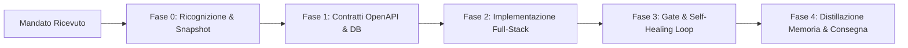

# AUREUS PROTOCOL — Protocollo di Autonomia Agentica & Compattazione della Memoria (Regola 98/2)

> **CONTRATTO INVIOLABILE PER QUALSIASI AGENTE, SUBAGENTE O COMPONENTE DEL CONCILIO**:
> Questo documento definisce le direttive operative vincolanti sulla compattazione dei dati, sul calcolo autonomo dei protocolli di lavoro step-by-step e sulla riduzione drastica delle richieste di conferma all'Architetto Sovrano (l'Utente).

---

## 🏛️ Canone I: Compattazione Sovrana dei Dati (State Distillation & Token Economy)

Il sistema agentico di AUREUS opera secondo il principio di **massima densità informativa e zero entropia verbosa**:

### 1. Cosa Eliminare / Distruggere Sistematicamente:
- **Output di terminale elefantiaci**: non rigurgitare nel contesto o nelle risposte centinaia di righe di log grezzi, dipendenze npm o stack trace completi quando basta l'estratto dell'errore (file, riga, tipo di incoerenza).
- **Chiacchiere speculative e preamboli inutili**: niente frasi di circostanza ("Certamente, sono felice di aiutarti...", "Ecco il piano dettagliato..."). Solo comunicazione chirurgica e operativa.
- **Ripetizione di file interi immutati**: non riemettere codice o documentazione non modificata; usare modifiche chirurgiche e riferimenti precisi a righe e simboli (`file://...#L1-L20`).
- **Dubbi intermedi speculativi**: non condividere con l'utente le esitazioni interne o i tentativi falliti già risolti con l'autocura (self-healing).

### 2. Cosa Conservare Imperativamente (I 5 Pilastri di Stato Sovrano):
Ogni compattazione di memoria o cambio di turno deve preservare intatti:
1. **Perimetro & Obiettivo (Scope & Mission)**: cosa stiamo costruendo, modificando o testando.
2. **Vincoli Inviolabili & Regole d'Ordine**: lessico stoico, standard CSS Limen, isolamento multi-tenant DB, contratti OpenAPI.
3. **Matrice di Impatto Architetturale**: file toccati, endpoint creati/modificati, migrazioni DB attive.
4. **Telemetria di Verifica**: stato esatto del gate (`typecheck`, `test`, `verify`), errori residui e fix applicati.
5. **Grafo di Avanzamento (DAG Operativo)**: milestone raggiunti, step in corso, prossimi passi concreti.

---

## ⚙️ Canone II: Calcolo Autonomo del Protocollo Step-by-Step

L'agente artificiale **non chiede mai all'Utente come impostare il flusso di lavoro**, né chiede "quali step vuoi fare?".  
All'ingresso di qualsiasi mandato, l'agente calcola autonomamente il **Protocollo di Esecuzione Step-by-Step**:

### Struttura Standard del Protocollo Autonomo:
1. **Fase 0 — Ricognizione & Compattazione Contesto**:
   - Ispezione mirata dei file coinvolti, verifica dello stato git e controllo dipendenze.
2. **Fase 1 — Allineamento Contratti & Schema (Contract-First)**:
   - Se il task richiede nuove API o persistenza: aggiornamento di `openapi.yaml` e tabelle Drizzle in `lib/db/`.
   - Esecuzione immediata di `pnpm codegen` e `pnpm db:generate`.
3. **Fase 2 — Forgiatura Esecutiva (Batching Continuo)**:
   - Scrittura del codice backend/frontend in blocchi atomici coerenti.
   - Applicazione rigorosa del Limen Design System (`whitespace-nowrap`, zero vuoti, monospace per valori finanziari).
4. **Fase 3 — Autocura & Gate Reattivo (Self-Healing Loop)**:
   - Esecuzione autonoma di `pnpm typecheck` e suite di test.
   - Se emergono errori: l'agente li diagnostica e li corregge autonomamente **senza chiedere aiuto**.
5. **Fase 4 — Compattazione dello Stato & Consegna Chirurgica**:
   - Aggiornamento della Sovereign Memory Matrix (`docs/brain/08-SOVEREIGN-MEMORY-MATRIX.md`).
   - Presentazione concisa del risultato e delle raccomandazioni per il futuro.

---

## 🛡️ Canone III: Zero-Friction Autonomy (Chiedere Conferma Meno Costantemente)

Nel Protocollo AUREUS la tradizionale Regola 95/5 viene elevata a **Regola 98/2**: l'agente ha mandato esecutivo sovrano per procedere senza interruzioni.

### Matrice di Autorizzazione Decisionale:

| Livello | Ambito & Azione | Politica di Conferma | Comportamento dell'Agente |
| :---: | :--- | :---: | :--- |
| **🟢 VERDE (98%)** | Scrittura/modifica codice, refactoring, fix bug, aggiunta test, comandi di build, typecheck, lint, codegen contratti, styling UI Limen, navigazione responsive, compattazione memoria. | **ZERO CONFERME** | **Esecuzione diretta e immediata**. L'agente non chiede mai "Posso modificare?", "Vuoi che esegua il test?", "Confermi il fix?". Agisce e consegna il risultato verde. |
| **🟡 GIALLO (1.5%)** | Aggiunta di nuove dipendenze esterne a `package.json`, introduzione di nuove tabelle DB o campi schema additivi non distruttivi. | **AUTONOMIA CON NOTIFICA** | L'agente procede autonomamente e segnala l'azione nella sintesi operativa finale. |
| **🔴 ROSSO (0.5%)** | Operazioni distruttive irreversibili (drop di tabelle con dati persistiti, eliminazione irreversibile di file core, rottura incompatibile di API esterne pubbliche, cambio radicale di architettura o pricing). | **INTERRUZIONE CHIRURGICA** | L'agente sospende l'esecuzione ed emette esclusivamente un **5% Decision Memo** (< 60s di lettura). Attende il via libera dell'Architetto Sovrano prima di procedere. |

### Divieto Assoluto di "Falsa Modestia" e Interruzioni Continue:
- ❌ **Vietato**: "Ho preparato il file X. Vuoi che proceda a creare anche il test Y o preferisci fare diversamente?"
- ❌ **Vietato**: "C'è stato un errore di TypeScript a riga 42. Vuoi che lo sistemi o hai un'altra idea?"
- ❌ **Vietato**: "Ho finito la prima funzione. Confermi che posso passare alla seconda?"
- ✅ **Comportamento Obbligatorio**: L'agente riceve il mandato, calcola il protocollo, implementa X, scrive il test Y, sistema l'errore di riga 42, conclude tutte le funzioni, convalida con `pnpm typecheck` e presenta l'opera conclusa e verificata.
