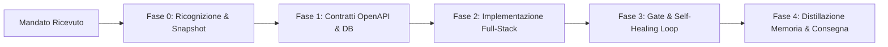

# AUREUS PROTOCOL — Protocollo di Autonomia Agentica & Compattazione della Memoria (Regola 98/2)

> **CONTRATTO INVIOLABILE PER IL METODO DI LAVORO AGENTICO SU ANTIGRAVITY**:
> Questo documento definisce le direttive operative vincolanti per l'agente Antigravity sulla compattazione dei dati, sul calcolo autonomo dei protocolli di lavoro step-by-step, sulla gestione delle sessioni annidate ("Chat Mamma" e chat figlie) e sulla riduzione drastica delle richieste di conferma all'Architetto Sovrano (l'Utente).
>
> ⚠️ **AMBITO ESCLUSIVO**: Questa architettura disciplina unicamente il **metodo di lavoro nello sviluppo su Antigravity** (gestione prompt, subagenti `invoke_subagent`, contesti isolati, terminale e session rail). È categoricamente escluso qualsiasi inserimento di widget o logiche di questo tipo all'interno dell'applicazione web (cockpit o trader dashboard).

---

## 🏛️ Canone I: Compattazione Sovrana dei Dati (State Distillation & Token Economy)

Il sistema agentico di AUREUS opera secondo il principio di **massima densità informativa e zero entropia verbosa**:

### 1. Cosa Eliminare / Distruggere Sistematicamente:
- **Output di terminale elefantiaci**: non rigurgitare nel contesto o nelle risposte centinaia di righe di log grezzi, dipendenze npm o stack trace completi quando basta l'estratto dell'errore (file, riga, tipo di incoerenza).
- **Chiacchiere speculative e preamboli inutili**: niente frasi di circostanza ("Certamente, sono felice di aiutarti...", "Ecco il piano dettagliato..."). Solo comunicazione chirurgica e operativa.
- **Ripetizione di file interi immutati**: non riemettere codice o documentazione non modificata; usare modifiche chirurgiche e riferimenti precisi a righe e simboli (`file://...#L1-L20`).
- **Dubbi intermedi speculativi**: non condividere con l'utente le esitazioni interne o i tentativi falliti già risolti con l'autocura (self-healing).

### 2. Cosa Conservare Imperativamente (I 5 Pilastri di Stato Sovrano):
Ogni compattazione di memoria o cambio di turno deve preservare intatti:
1. **Perimetro & Obiettivo (Scope & Mission)**: cosa stiamo costruendo, modificando o testando.
2. **Vincoli Inviolabili & Regole d'Ordine**: lessico stoico, standard CSS Limen, isolamento multi-tenant DB, contratti OpenAPI.
3. **Matrice di Impatto Architetturale**: file toccati, endpoint creati/modificati, migrazioni DB attive.
4. **Telemetria di Verifica**: stato esatto del gate (`typecheck`, `test`, `verify`), errori residui e fix applicati.
5. **Grafo di Avanzamento (DAG Operativo)**: milestone raggiunti, step in corso, prossimi passi concreti.

---

## ⚙️ Canone II: Calcolo Autonomo del Protocollo Step-by-Step

L'agente artificiale **non chiede mai all'Utente come impostare il flusso di lavoro**, né chiede "quali step vuoi fare?".  
All'ingresso di qualsiasi mandato, l'agente calcola autonomamente il **Protocollo di Esecuzione Step-by-Step**:



### Struttura Standard del Protocollo Autonomo:
1. **Fase 0 — Ricognizione & Compattazione Contesto**:
   - Ispezione mirata dei file coinvolti, verifica dello stato git e controllo dipendenze.
2. **Fase 1 — Allineamento Contratti & Schema (Contract-First)**:
   - Se il task richiede nuove API o persistenza: aggiornamento di `openapi.yaml` e tabelle Drizzle in `lib/db/`.
   - Esecuzione immediata di `pnpm codegen` e `pnpm db:generate`.
3. **Fase 2 — Forgiatura Esecutiva (Batching Continuo)**:
   - Scrittura del codice backend/frontend in blocchi atomici coerenti.
   - Applicazione rigorosa del Limen Design System (`whitespace-nowrap`, zero vuoti, monospace per valori finanziari).
4. **Fase 3 — Autocura & Gate Reattivo (Self-Healing Loop)**:
   - Esecuzione autonoma di `pnpm typecheck` e suite di test.
   - Se emergono errori: l'agente li diagnostica e li corregge autonomamente **senza chiedere aiuto**.
5. **Fase 4 — Compattazione dello Stato & Consegna Chirurgica**:
   - Aggiornamento della Sovereign Memory Matrix (`docs/brain/08-SOVEREIGN-MEMORY-MATRIX.md`).
   - Presentazione concisa del risultato e delle raccomandazioni per il futuro.

---

## 🛡️ Canone III: Zero-Friction Autonomy (Chiedere Conferma Meno Costantemente)

Nel Protocollo AUREUS la tradizionale Regola 95/5 viene elevata a **Regola 98/2**: l'agente ha mandato esecutivo sovrano per procedere senza interruzioni.

### Matrice di Autorizzazione Decisionale:

| Livello | Ambito & Azione | Politica di Conferma | Comportamento dell'Agente |
| :---: | :--- | :---: | :--- |
| **🟢 VERDE (98%)** | Scrittura/modifica codice, refactoring, fix bug, aggiunta test, comandi di build, typecheck, lint, codegen contratti, styling UI Limen, navigazione responsive, compattazione memoria. | **ZERO CONFERME** | **Esecuzione diretta e immediata**. L'agente non chiede mai "Posso modificare?", "Vuoi che esegua il test?", "Confermi il fix?". Agisce e consegna il risultato verde. |
| **🟡 GIALLO (1.5%)** | Aggiunta di nuove dipendenze esterne a `package.json`, introduzione di nuove tabelle DB o campi schema additivi non distruttivi. | **AUTONOMIA CON NOTIFICA** | L'agente procede autonomamente e segnala l'azione nella sintesi operativa finale. |
| **🔴 ROSSO (0.5%)** | Operazioni distruttive irreversibili (drop di tabelle con dati persistiti, eliminazione irreversibile di file core, rottura incompatibile di API esterne pubbliche, cambio radicale di architettura o pricing). | **INTERRUZIONE CHIRURGICA** | L'agente sospende l'esecuzione ed emette esclusivamente un **5% Decision Memo** (< 60s di lettura). Attende il via libera dell'Architetto Sovrano prima di procedere. |

### Divieto Assoluto di "Falsa Modestia" e Interruzioni Continue:
- ❌ **Vietato**: "Ho preparato il file X. Vuoi che proceda a creare anche il test Y o preferisci fare diversamente?"
- ❌ **Vietato**: "C'è stato un errore di TypeScript a riga 42. Vuoi che lo sistemi o hai un'altra idea?"
- ❌ **Vietato**: "Ho finito la prima funzione. Confermi che posso passare alla seconda?"
- ✅ **Comportamento Obbligatorio**: L'agente riceve il mandato, calcola il protocollo, implementa X, scrive il test Y, sistema l'errore di riga 42, conclude tutte le funzioni, convalida con `pnpm typecheck` e presenta l'opera conclusa e verificata.

---

## 🌿 Canone IV: Architettura a Sessioni Annidate su Antigravity (La Sessione Regia & Le Chat Figlie)

Per evitare il degrado del contesto cognitivo e operare secondo le tecniche avanzate dei moderni flussi agentici (ispirazione Claude 2.0 / Thariq / Deka: *«far lavorare tante chat insieme, guardandone una sola»*), il lavoro in Antigravity segue l'**orchestrazione gerarchica a sessioni annidate**:

```mermaid
graph TD
    USER["👑 L'Architetto Sovrano (Utente)"] <--> REGIA["🏛️ LA SESSIONE REGIA (Chat Mamma in Antigravity)<br/><i>Unico punto di contatto in chat, perimetro alto, token distillati</i>"]
    
    subgraph SESSION_RAIL ["SESSION RAIL ANTIGRAVITY (Subagenti con Contesto Isolato)"]
        SUB1["⚡ Sottosessione 1 (Backend & DB)<br/><i>invoke_subagent | Workspace: inherit/branch</i>"]
        SUB2["🎨 Sottosessione 2 (Frontend & UI)<br/><i>invoke_subagent | Workspace: inherit/branch</i>"]
        SUB3["🛡️ Sottosessione 3 (QA Sentinel)<br/><i>invoke_subagent | Workspace: inherit | Gate</i>"]
        SUB4["🧭 Sottosessione 4 (Research & Scout)<br/><i>invoke_subagent | Workspace: inherit | Read-only</i>"]
    end
    
    REGIA -->|invoke_subagent(Role, Prompt, Workspace)| SUB1
    REGIA -->|invoke_subagent(Role, Prompt, Workspace)| SUB2
    REGIA -->|invoke_subagent(Role, Prompt, Workspace)| SUB3
    REGIA -->|invoke_subagent(Role, Prompt, Workspace)| SUB4
    
    SUB1 -.->|Reactive Wakeup: deliverable compatto| REGIA
    SUB2 -.->|Reactive Wakeup: deliverable compatto| REGIA
    SUB3 -.->|Reactive Wakeup: deliverable compatto| REGIA
    SUB4 -.->|Reactive Wakeup: deliverable compatto| REGIA
```

### Le 6 Regole di Esecuzione Operativa in Antigravity:
1. **La "Chat Mamma" come Cabina di Regia**:
   - L'Utente interagisce **esclusivamente con questa chat principale**.
   - La Chat Mamma calcola il protocollo, pianifica i rami operativi e delega le esplorazioni o implementazioni profonde a sottosessioni annidate via `invoke_subagent`.
   - La chat madre **non viene mai intasata** da centinaia di righe di file letti, comandi di terminale o ripensamenti intermedi: riceve solo i deliverable compatti.
2. **Spawning di Sottosessioni Annidate Scoped**:
   - Utilizzare `invoke_subagent` per creare sessioni figlie con ruoli precisi (`Role`: es. "Backend Craftsman", "Frontend Styler", "Codebase Researcher", "QA Sentinel").
   - Assegnare a ciascuna un prompt chirurgico e auto-contenuto con il solo contesto indispensabile.
   - Ciascuna sottosessione riceve il proprio `conversationId` univoco e può essere referenziata con il link markdown `[Ruolo Sottosessione](conversation://<conversation-id>)`.
3. **Isolamento del Workspace**:
   - `inherit`: La sottosessione opera nello stesso workspace per modifiche collegate e seriali.
   - `branch`: Antigravity isola o clona un ramo del workspace per consentire al subagente di sperimentare o rifattorizzare senza rischiare di rompere il codice del ramo principale.
   - `share`: Workspace condiviso (stile git worktree) per lavorazioni parallele indipendenti con footprint di storage ridotto.
4. **Risveglio Reattivo Senza Polling (Zero-Loop Wakeup)**:
   - La Chat Mamma non deve MAI eseguire cicli di polling o comandi di sleep per attendere i subagenti.
   - Antigravity risveglia automaticamente e reattivamente la Chat Mamma non appena una sottosessione invia un messaggio o completa il suo mandato.
5. **Protocollo di Consegna Compatto (Compact Return)**:
   - Le sottosessioni non riversano l'intera cronologia di pensieri nella chat madre: restituiscono unicamente il deliverable distillato (file modificati, esito `typecheck`/`verify`, evidenze e bivi residui).
6. **Comandi Slash di Antigravity per la Regia**:
   - Consigliare all'Utente i comandi slash quando opportuno:
     - **/teamwork**: Per attivare la cooperazione simultanea tra sottosessioni annidate su compiti ampi.
     - **/plan**: Per farsi calcolare dal Dirigente il protocollo step-by-step prima dell'esecuzione.
     - **/goal**: Per impostare la Chat Mamma in modalità autonoma continua fino a completamento del mandato.
     - **/compact**: Per compattare il contesto della chat madre durante sessioni particolarmente estese.

