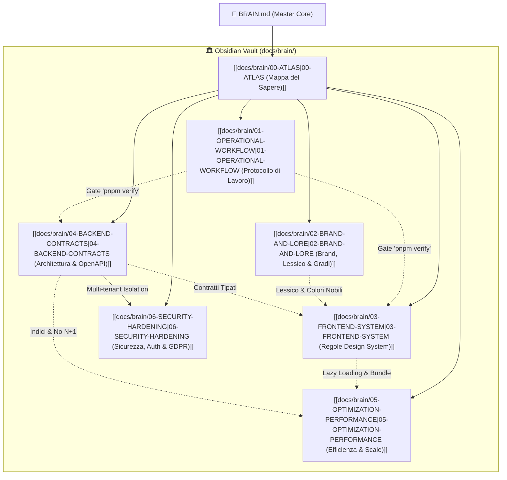

# 👑 AUREUS OS — Master Brain & Sovereign Operational Memory

> «Nel mercato, come nell'esistenza, l'umanità si divide in due sole categorie: coloro che vivono nella Deriva e coloro che scelgono di attraversare Il Varco.  
> Chi abita la Deriva reagisce agli impulsi, cerca il colpo di fortuna, cede all'emotività e diventa inevitabilmente carburante e liquidità per il sistema.  
> AUREUS non è un'applicazione per scommettitori retail. È un Ordine operativo basato sul **Codice della Presenza e dell'Eredità**.»  
> — *Il Manifesto AUREUS*

Questo file costituisce la **memoria centrale, sovrana e inviolabile** del repository **AUREUS (AUREUS PROTOCOL / AUREUS OS)**.  
Qualsiasi agente artificiale, ingegnere del software, designer o operatore che lavora su questa codebase ha l'**obbligo vincolante** di consultare, rispettare ed eseguire le direttive qui codificate.

---

## 🗺️ Grafo Concettuale del Vault (Obsidian Knowledge Graph)



---

## 1. ⚙️ PROTOCOLLO OPERATIVO & COME SI LAVORA

> [!IMPORTANT]
> **REGOLA ZERO**: Nessuna modifica è considerata terminata senza l'esito **verde** dell'intero gate di rilascio. È categoricamente vietato speculare, supporre il funzionamento senza test o applicare modifiche alla cieca.

### A. Mappa dell'Architettura Monorepo (pnpm)
```
TraderLoadingsLOCALE/
├── artifacts/
│   ├── api-server/         # Backend Express 5 + TS (REST, WebSockets, Cron Jobs)
│   └── trader-dashboard/   # Frontend React 19 + Vite 7 + Wouter (SPA)
├── lib/
│   ├── api-spec/           # openapi.yaml: Singola Fonte di Verità dei Contratti
│   ├── api-zod/            # Schemi Zod generati da Orval (Non editare a mano)
│   ├── api-client-react/   # Client React Query generato da Orval (Non editare a mano)
│   ├── db/                 # Drizzle ORM schema + Migrazioni PostgreSQL
│   ├── pair-catalog/       # Catalogo ufficiale coppie e strumenti di mercato
│   └── integrations/       # Integrazioni server (OpenAI, Dukascopy, etc.)
├── contracts/              # Lore AUREUS, Gradi, Lessico e Costanti di Dominio
├── docs/                   # Specifiche architetturali e vault [[docs/brain/00-ATLAS]]
└── scripts/                # Script di orchestrazione locale (tsx)
```

### B. I Comandi d'Oro della Fonderia
Esegui sempre i comandi dalla radice del monorepo:

1. **Il Gate Assoluto di Rilascio**:
   ```bash
   pnpm verify
   ```
   *Esegue in sequenza*: install check → codegen contratti → typecheck strict monorepo → test suite → build di produzione e verifica prerender. Deve passare con zero errori prima di considerare finito qualsiasi compito.

2. **Generazione Contratti OpenAPI (Contract-First)**:
   ```bash
   pnpm codegen
   ```
   *Obbligatorio* ogni volta che si modifica `lib/api-spec/openapi.yaml`. Non toccare mai manualmente i file in `lib/api-zod/` o `lib/api-client-react/`.

3. **Typecheck Rigoroso**:
   ```bash
   pnpm typecheck
   ```
   Controllo TypeScript strict in tutto il monorepo. Vietati cast casuali ad `any` in codice di produzione.

4. **Test Suite**:
   ```bash
   pnpm test
   ```
   Esecuzione immediata di tutti i test unitari e di integrazione.

### C. Gestione del Database (Drizzle ORM)
- **Generazione Nuove Migrazioni**: `pnpm db:generate`
- **Applicazione Migrazioni**: `pnpm db:migrate`
- **Divieto di `push-force`**: Severamente vietato eseguire `pnpm db:push-force` o comandi distruttivi su database contenenti dati.
- **Sincronizzazione Sequenze**: Mantenere la sequenza `drizzle.__drizzle_migrations_id_seq` allineata al numero massimo delle migrazioni applicate per scongiurare collisioni di ID.

### D. Stack Locale & Smoke Testing
- **Avvio Completo Stack**: `pnpm start:local` (PostgreSQL `5432`/`55432`, API `3001`, Vite `5173`).
- **Smoke Test Runtime Veloce (Non bloccante)**:
  ```bash
  pnpm smoke:runtime
  ```
  Rigenera i contratti, avvia temporaneamente i processi necessari, verifica la connettività di backend, frontend e proxy `/api`, controlla i log per `RUNTIME_ERROR` e termina i processi in modo pulito.

### E. Protocollo di Chiusura Lavori: Proattività Architetturale & Step Successivi
> [!IMPORTANT]
> **A LAVORO FINITO, PROPORRE SEMPRE NUOVE IDEE E SOLUZIONI**:
> Al termine di ogni sessione o completamento di un task, l'agente o l'ingegnere ha l'obbligo di:
> 1. Non limitarsi a confermare il lavoro svolto in modo passivo.
> 2. Presentare proattivamente **nuove idee, ottimizzazioni e soluzioni** per elevare il valore dell'applicazione (performance, UX, design d'Ordine, telemetria).
> 3. Definire una **roadmap ordinata passo-passo** per avanzare con metodo chirurgico e senza regressioni.

Per approfondire: consulta la nota atomica **[[docs/brain/01-OPERATIONAL-WORKFLOW]]**.

---

## 2. 🏛️ BRAND, LORE & LESSICO SOVRANO AUREUS

> [!NOTE]
> AUREUS non è una piattaforma di scommesse retail, né un videogioco arcade con punti XP. È un **Ordine Operativo e Spirituale** basato sul *Codice della Presenza e dell'Eredità*: rigore matematico, disciplina monastica, architettura sovrana ed esecuzione priva di esitazione.

### A. Tono di Voce
- **Stile**: Solenne, stoico, chirurgico, nobile, austero, architettonico.
- **Titoli**: *L'Operatore*, *L'Iniziato*, *L'Architetto*, *Il Maestro Fondatore*.

### B. Tabella di Corrispondenza Lessicale Inviolabile
È categoricamente vietato l'uso di termini generici, gergo arcade o espressioni da gioco d'azzardo:

| Termine Vietato (Retail / Gaming / Generico) | Termine Obbligatorio AUREUS | Significato Operativo |
| :--- | :--- | :--- |
| **TraderLoading / Limen** | **AUREUS / AUREUS PROTOCOL** | Il nome sovrano dell'ecosistema e dell'OS |
| **Backtest / Simulatore generico** | **La Forgia del Passato / Banco di Forgiatura** | Affilare la visione nell'ombra prima della battaglia |
| **Trading Journal / Diario** | **Il Libro della Verità** | Registro spietato delle scelte e dell'integrità; i dati non mentono |
| **Checklist Pre-Trade / Filtro entrate** | **Il Custode della Soglia** | Filtro decisionale: agisci per lucidità o per debolezza? |
| **Routine / Daily task** | **L'Ordine Giornaliero** | Sequenza rituale e inviolabile; nessuna azione fuori protocollo |
| **Classifica / Leaderboard / Punti XP** | **La Gerarchia dell'Integrità / Indice di Integrità** | Il rango si conquista con la fedeltà al Codice, non si acquista |
| **Tornei / Gare / Partite** | **Le Prove del Fuoco / Arene della Disciplina** | Competizioni trimestrali di gestione del rischio e disciplina |
| **Profilo utente / Impostazioni** | **Dossier dell'Operatore** | Registro storico del grado, dell'integrità e dei privilegi |
| **Chat / Social / Community** | **La Fratellanza (Agorà dell'Ordine)** | Confronto tra pari: zero rumore, solo analisi e progresso |
| **Formazione / Video academy** | **La Dottrina del Tempo** | L'Arte dell'Assedio (Swing) e L'Arte del Duello (Scalp) |
| **Livelli di gioco (Lvl 1, Lvl 2...)** | **I 5 Gradi di Ascesa** | I 5 ranghi d'Ordine basati sull'Indice di Integrità |
| **Utente / Player / Scommettitore** | **L'Operatore / L'Iniziato / L'Architetto** | Persona che governa se stessa e le proprie decisioni |
| **Perdita emotiva / Gioco d'azzardo / Tilt** | **La Deriva** | Condizione di chi è dominato dalle pulsioni interiori |
| **Transizione al controllo conscio / Home** | **Il Varco (Centro di Comando)** | La soglia di passaggio dalla Deriva al governo conscio |
| **Shop / Merch / Store** | **L'Arsenale e L'Espansione** | Dotazioni fisiche e uniformi d'Ordine, sbloccate per merito |

### C. I 5 Gradi di Ascesa & Indice di Integrità
1. **Grado I — Novizio Consapevole**: Ingresso nell'Ordine tramite la sottoscrizione de *Il Patto di Ingresso alla Soglia di Selezione*. Accesso agli strumenti base.
2. **Grado II — Il Custode della Regola**: Raggiunto dopo **30 sessioni consecutive al 100% di Integrità** ne *Il Libro della Verità*. Sblocca «Il Tempio Fisico» e «Il Mandato di Espansione» (Royalty 20%).
3. **Grado III — L'Osservatore Sovrano**: Raggiunto dopo **90 giorni (1 trimestre)** di costanza verificata. Sblocca diritto di parola a «Il Concilio della Domenica» e i capi de «L'Uniforme».
4. **Grado IV — L'Architetto del Reale**: Raggiunto dopo 180 giorni di eccellenza. Accesso alla divisione Corporate/B2B e abilitazione come Docente d'Ordine.
5. **Grado V — Il Maestro Fondatore**: Riservato al consiglio direttivo e ai custodi fondatori dell'Ordine.

Per approfondire: consulta la nota atomica **[[docs/brain/02-BRAND-AND-LORE]]**.

---

## 3. 🎨 REGOLE FISSE & RIGIDE: FRONTEND & DESIGN SYSTEM

> [!IMPORTANT]
> **CONTRATTO INVIOLABILE UI/UX**: L'interfaccia di AUREUS è un cockpit decisionale ad alta densità. Ogni deviazione dai principi sottostanti costituisce un difetto critico da respingere.

### A. Palette Cromatica Ufficiale
```css
/* Nero Ossidiana & Oro Imperiale */
--limen-bg-obsidian:    #07080b; /* Sfondo sovrano più profondo */
--limen-bg-panel:       #0d0f14; /* Pannelli primari */
--limen-bg-subpanel:    #11131c; /* Contenitori interni e card */

--limen-gold-base:      #C5A059; /* Oro aureo imperiale */
--limen-gold-glow:      #E8C56A; /* Oro chiaro per testi e accenti */
--limen-gold-hover:     #F3D88C; /* Oro di interazione attiva */
--limen-gold-border:    rgba(197, 160, 89, 0.22); /* Bordi nobili */

--limen-emerald:        #10b981; /* Smeraldo dell'Integrità (P&L positivo, vittoria) */
--limen-crimson:        #ef4444; /* Rubino della Disciplina (Drawdown, violazione stop) */
--limen-slate-subtle:   #94a3b8; /* Testi secondari e metadati neutri */
```
*Divieto assoluto di gradienti arcobaleno, viola neon o accenti da casinò retail.*

### B. Le 7 Regole Inviolabili di Layout & Presentazione
1. **Zero Vuoti Ingiustificati**:
   - Vietate aree morte o mezze schermate vuote.
   - Saturare lo spazio libero con telemetria operativa pertinente (timer di mercato, profit factor, micro-statistiche).
   - **Bilanciamento Colonne (`flex-stretch`)**: Due card o colonne affiancate devono avere altezze armonizzate. Vietati scalini visivi disordinati.
2. **Zero Muri di Testo (No Dense Walls of Text)**:
   - Sintesi chirurgica: ogni informazione deve essere fruibile in **meno di 2 secondi**.
   - Nessun paragrafo descrittivo o di istruzione deve superare **1–2 righe**.
   - Preferire sempre elenchi a badge, icone semantiche Lucide (`ShieldCheck`, `Crosshair`, `Flame`, `Zap`) e strutture `Etichetta: Valore`.
3. **Divieto Assoluto di Separare Numeri e Unità (`whitespace-nowrap`)**:
   - Qualsiasi valore numerico, percentuale, valuta o unità deve viaggiare unito con la classe `whitespace-nowrap`:
     - ❌ `Drawdown Massimo \n 10%` ➡️ ✅ `<span className="whitespace-nowrap">Drawdown Massimo 10%</span>`
     - ❌ `+ \n $1,450.00` ➡️ ✅ `<span className="whitespace-nowrap">+$1,450.00</span>`
     - ❌ `5 \n Trade` ➡️ ✅ `<span className="whitespace-nowrap">5 Trade</span>`
     - ❌ `15 \n min` ➡️ ✅ `<span className="whitespace-nowrap">15 min</span>`
4. **Divieto Assoluto di Troncamenti Prematuri (`..`)**:
   - Vietato applicare `truncate` indiscriminatamente provocando diciture sfigurate come `GARIKFX VS MA..`.
   - Garantire `min-w-0` sul genitore flex e una larghezza minima (`min-w-[120px]`) per i nomi di sfidanti o asset.
   - **Zero Parole Orfane**: Nessun titolo deve lasciare una singola parola sola su una riga per difetto di pochi pixel.
5. **Viewport Fitting & Visibilità Testata**:
   - La testata operativa (`BANCO DI FORGIATURA`, barra KPI, controlli globali) non deve **mai** essere tagliata o spinta fuori viewport.
   - Gestione dello scroll esclusivamente con `overflow-y-auto` interno e scrollbar dorata discreta (`scrollbar-thin scrollbar-thumb-[#C5A059]/30`). Vietati scroll doppi annidati.
6. **Divieto Assoluto di Tag Brutti o Tecnici**:
   - Banditi residui di debug grezzi come `"DB"`, `"ORVAL"`, `"SCHEMA"`, `"MOCK"`, `"LOCAL"`, `"TEST"`.
   - Solo status chip nobili: `font-mono text-[9px] uppercase font-bold tracking-wider px-1.5 py-0.5 rounded` con bordi e sfondi armonizzati in oro, smeraldo o rubino.
7. **Tipografia Finanziaria Monospace**:
   - Tutti i valori monetari (`+$1,250.00`), percentuali (`+15.20%`), pips (`+42.5 pips`), R:R (`1.85 R`), date e orari (`14:30:00`) devono usare obbligatoriamente `font-mono tracking-tight`.

### C. Standard Tecnici React 19 & Radix
- **Stabilità dei Callback Ref**: Pinned `@radix-ui/react-slot@1.5.0`. Mai passare callback ref anonime inline dentro componenti animati (`Presence`), per evitare il crash di ciclo infinito `Maximum update depth exceeded`.
- **Accessibilità Overlay (`useDialogA11y`)**: Ogni modale o cassetto custom deve implementare il focus-trap e il ripristino del focus alla chiusura.
- **Mobile Clearance**: Includere sempre `pb-20` o `pb-24` sui contenitori a scorrimento mobile per evitare che l'ultima riga venga nascosta dalla bottom bar.

Per approfondire: consulta la nota atomica **[[docs/brain/03-FRONTEND-SYSTEM]]**.

---

## 4. 🛡️ REGOLE FISSE & RIGIDE: BACKEND & ARCHITETTURA

> [!IMPORTANT]
> **CONTRATTO INVIOLABILE BACKEND**: Nessun endpoint esiste senza il suo contratto OpenAPI. I dati personali e finanziari devono essere isolati con rigore matematico.

### A. Flusso Contract-First Assoluto
1. La sola sorgente di verità è `lib/api-spec/openapi.yaml`.
2. Le modifiche agli endpoint, parametri e DTO si effettuano solo in `openapi.yaml`.
3. Si esegue `pnpm codegen` per generare simultaneamente:
   - Gli schemi Zod per il backend in `lib/api-zod/`.
   - Il client React Query tipato per il frontend in `lib/api-client-react/`.
4. È severamente vietato modificare a mano i file generati da Orval.

### B. Isolamento Multi-Tenant per `userId`
- Ogni query verso tabelle contenenti dati utente deve contenere tassativamente la clausola di scoping:
  ```typescript
  eq(table.userId, req.auth.userId)
  ```
- Non accettare mai `userId` dal body o dai parametri query del client per autorizzare accessi o scritture. L'identità utente valida proviene esclusivamente dal token Clerk decodificato nel backend.

### C. Transazionalità Finanziaria & Zero TOCTOU
- Per mutazioni di saldo, acquisti di corsi, sblocco canali o ordini a mercato, acquisire sempre un lock transazionale esplicito:
  ```typescript
  await db.transaction(async (tx) => {
    await tx.execute(sql`SELECT pg_advisory_xact_lock(hashtext(${userId}))`);
    // Esecuzione atomica
  });
  ```
- **Idempotenza Pagamenti**: Ogni webhook di fatturazione (`routes/billing.ts`) verifica l'ID evento univoco (`stripe_event_id`) prima di accreditare qualsiasi privilegio.
- **Marketplace Disintermediato**: Modello Stripe Connect Express. La piattaforma non custodisce fondi utente; i pagamenti transitano con Destination Charges verso i conti connessi.

### D. Logging Strutturato Pino
- Utilizzare logger strutturato con correlation ID.
- Vietato loggare dati sensibili (token, password, PII, chiavi private).

Per approfondire: consulta la nota atomica **[[docs/brain/04-BACKEND-CONTRACTS]]**.

---

## 5. ⚡ OTTIMIZZAZIONE & PERFORMANCE

> [!NOTE]
> Ogni millisecondo risparmiato preserva la prontezza decisionale dell'Operatore al momento dell'attraversamento de Il Varco.

1. **Frontend Bundle (< 300 kB gzip eager)**:
   - Lazy loading obbligatorio (`React.lazy`) per widget pesanti: terminale replay grafici (`lightweight-charts`), widget macro COT e player video.
   - Suddivisione Rollup in chunk modulari (`vendor`, `radix`, `charts`, `query`).
2. **Disciplina di Polling & Rete**:
   - Pattern Stale-While-Revalidate (SWR): render immediato da cache, aggiornamento asincrono silenzioso.
   - Backoff automatico: rallentamento o sospensione del polling quando la scheda del browser è in background (`document.hidden`).
   - Cleanup rigoroso di `setInterval`, listener di eventi e WebSocket al momento dello smontaggio dei componenti.
3. **Ottimizzazione Database PostgreSQL & Scaling**:
   - Creazione di indici compositi su `(userId, createdAt DESC)` per tutte le tabelle ad alto volume di lettura.
   - 11 indici di scalabilità dedicati per affiliazioni, lobby, wiki e ordini dell'Arsenale.
   - Statement timeout del connection pool (`PG_STATEMENT_TIMEOUT_MS`) contro query bloccanti.
   - Eliminazione totale di query N+1: raggruppare i fetch con `inArray` o relazioni Drizzle (`with: { ... }`).
   - Paginazione su tutte le liste potenzialmente illimitate.
4. **Resilienza Backend ad Alta Concorrenza (Massive Multi-User)**:
   - Keep-Alive a 65s/66s per allineamento a proxy cloud (ALB, Cloudflare, Railway) eliminando errori 502.
   - Circuit Breaker a 3 stati su feed esterni (TwelveData, Yahoo, Dukascopy) per fail-fast istantaneo.
   - Thundering herd mitigation con `singleFlight` sulla richiesta simultanea di candele.
   - LRU Bounded Cache Layer in-memory limitata a 5.000 chiavi per prevenire memory leak.
   - Real-time WebSockets multi-container distribuiti su Redis Pub/Sub (Social Hub e Arene di Duello).
   - Sweeper periodico di deallocazione delle stanze orfane e timer della Forgia.

Per approfondire: consulta la nota atomica **[[docs/brain/05-OPTIMIZATION-PERFORMANCE]]**.

---

## 6. 🔒 SICUREZZA, AUTH & HARDENING

> [!CAUTION]
> Qualsiasi vulnerabilità o fuga di credenziali compromette l'intero Ordine. La sicurezza è garantita per impostazione predefinita (Security by Default).

1. **Autenticazione Clerk**:
   - Verifica crittografica rigorosa del token JWT nel backend tramite `@clerk/express`.
   - Separazione ermetica tra utenze locali di sviluppo (`pk_test`/`sk_test`) e utenze di produzione.
   - Istanza su dominio personalizzato senza proxy URL (`VITE_CLERK_PROXY_URL` disattivato per scongiurare black-screen e man-in-the-middle).
2. **Validazione Rigorosa degli Input con Zod**:
   - Nessun dato proveniente dall'esterno tocca la logica di business senza essere prima passato attraverso `schema.safeParse(req.body)`.
   - Tutte le query SQL sono tipate ed eseguite tramite parametri vincolati in Drizzle (nessuna concatenazione di stringhe SQL).
3. **Diritto all'Oblio & Conformità GDPR**:
   - Procedura di cancellazione account a cascata automatizzata in `accountDeletion.ts`.
   - Alla richiesta di cancellazione vengono purgate tutte le righe utente (trade, iscrizioni alle prove del fuoco, diari, note, allegati, log personali).
4. **Protezione Upload e Streaming**:
   - Validazione del tipo MIME reale dei file tramite ispezione dei magic bytes prima del salvataggio su disco o bucket.
   - I video dell'Academy (Cloudflare Stream) e i file privati richiedono **URL firmati** con validità limitata (massimo 3 ore).
5. **Gestione Segreti & Dark-by-Default**:
   - Tutte le chiavi API esterne (Stripe, Cloudflare, Resend, Sentry) risiedono unicamente nei file di ambiente `.env.local` / configurazione di deployment.
   - Le feature a pagamento o di notifica rimangono spente di default finché le relative variabili non sono esplicitamente dichiarate.

Per approfondire: consulta la nota atomica **[[docs/brain/06-SECURITY-HARDENING]]**.

---

## 📋 CHECKLIST OPERATIVA DI FINE SESSIONE

Prima di dichiarare concluso qualsiasi intervento o considerare pronto un rilascio:

- [ ] **1. Spazi & Vuoti**: C'è spazio morto o asimmetria tra le colonne affiancate? (Risolto con `flex-stretch` o saturazione operativa).
- [ ] **2. Muri di Testo**: Ci sono paragrafi più lunghi di 2 righe? (Risolto sintetizzando in badge o metriche compatte).
- [ ] **3. Troncamenti**: C'è qualche `..` antiestetico su nomi, titoli o sfide? (Risolto con `min-w-0` e layout elastico).
- [ ] **4. Line-Wrap**: Qualche numero è finito a capo separato dalla sua unità (`%`, `$`, `Trade`)? (Risolto con `whitespace-nowrap`).
- [ ] **5. Viewport & Header**: Il titolo e la barra superiore sono completamente visibili senza clipping?
- [ ] **6. Tag & Badges**: Sono spariti tutti i tag di debug e le chip hanno lo stile nobiliare AUREUS?
- [ ] **7. Lessico d'Ordine**: I testi rispettano la tabella AUREUS (nessun gergo gambling o retail)?
- [ ] **8. Contratti OpenAPI**: Ho eseguito `pnpm codegen` se ho modificato le API?
- [ ] **9. Typecheck**: `pnpm typecheck` passa con 0 errori?
- [ ] **10. Release Gate**: `pnpm verify` è completamente verde?
- [ ] **11. Proattività Finale**: Ho proposto all'utente nuove idee, ottimizzazioni e i prossimi step ordinati passo-passo?
