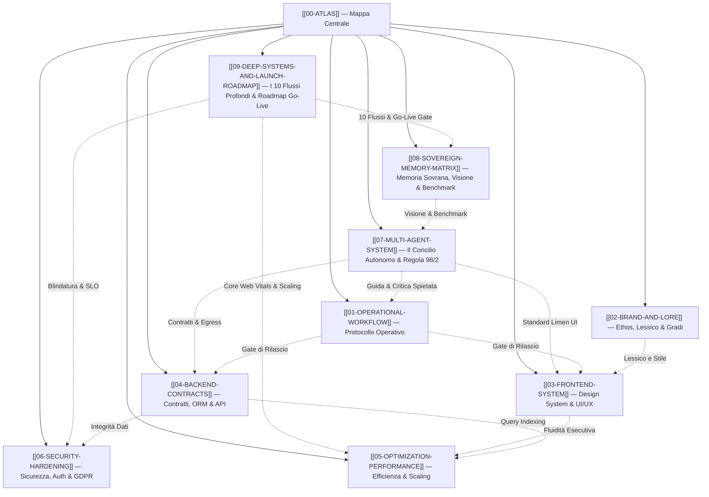

# 🏛️ ATLAS — Mappa Concettuale del Sapere AUREUS

> «Nel mercato, come nell'esistenza, l'umanità si divide in due sole categorie: coloro che vivono nella Deriva e coloro che scelgono di attraversare Il Varco.»  
> — *Il Manifesto AUREUS*

Benvenuto nel nucleo di conoscenza di **AUREUS OS (AUREUS PROTOCOL)**. Questo vault è strutturato per fungere da cervello operativo, decisionale e ingegneristico dell'intero ecosistema.

---

## 🗺️ Mappa dei Contenuti (MOC)

Naviga attraverso i moduli fondamentali del protocollo:

---

## 📚 Indice delle Note Atomiche

1. **[[01-OPERATIONAL-WORKFLOW]]** — *Come si Lavora nel Monorepo*
   - Comandi canonici (`pnpm verify`, `pnpm codegen`, `pnpm typecheck`).
   - Gestione database e migrazioni Drizzle (divieto di `push-force`).
   - Stack locale, test runner e disciplina pre-rilascio.
   - Metodo di lavoro su Antigravity: La Chat Mamma (Sessione Regia) e sessioni annidate.

2. **[[02-BRAND-AND-LORE]]** — *L'Ordine Operativo & Spirituale*
   - Ethos AUREUS: architettura sovrana, rigore monastico, stoicismo.
   - Tabella di conversione lessicale: termini vietati vs obbligatori.
   - I 5 Gradi di Ascesa (Novizio -> Custode -> Osservatore -> Architetto -> Maestro).
   - L'Indice di Integrità e i 3 Pilastri del Manifesto.

3. **[[03-FRONTEND-SYSTEM]]** — *Cockpit Decisionale & Design System*
   - Palette Ossidiana e Oro Imperiale (`#07080b`, `#0d0f14`, `#C5A059`, `#E8C56A`).
   - Regola anti-vuoto: saturazione operativa e colonne bilanciate (`flex-stretch`).
   - Sintesi chirurgica: zero muri di testo (max 1-2 righe).
   - Regola inviolabile: `whitespace-nowrap` su numeri, valute e unità.
   - Divieto di troncamenti impropri (`..`) e divieto di tag tecnici/debug (`DB`, `TEST`).
   - Tipografia finanziaria in monospace (`font-mono tracking-tight`).

4. **[[04-BACKEND-CONTRACTS]]** — *Contratti, API & Persistenza*
   - OpenAPI come sorgente singola di verità (`openapi.yaml` -> Orval).
   - Isolamento multi-tenant universale (`userId` obbligatorio).
   - Transazionalità finanziaria (`pg_advisory_xact_lock`), zero TOCTOU.
   - Modello marketplace disintermediato con Stripe Connect Express.
   - Logging strutturato con Pino e gestione correlata degli errori.

5. **[[05-OPTIMIZATION-PERFORMANCE]]** — *Efficienza e Resilienza*
   - Code splitting, chunking Rollup e caricamento lazy dei widget pesanti.
   - Disciplina del polling: Stale-While-Revalidate (SWR) e backoff su inattività.
   - Ottimizzazione PostgreSQL: indici compositi e debellamento query N+1.
   - Stabilità reattiva in React 19: callback ref memoizzati e zero loop di rendering.

6. **[[06-SECURITY-HARDENING]]** — *Fortezza Operativa & Privacy*
   - Autenticazione Clerk e autorizzazione RBAC a livello di rotta.
   - Validazione schemi universale con Zod su ogni input utente.
   - Cascata GDPR di cancellazione completa (`accountDeletion.ts`).
   - Upload protetti: validazione MIME reale e URL firmati a scadenza (Cloudflare Stream/S3).
   - Igiene assoluta delle credenziali e flags spenti di default.

7. **[[07-MULTI-AGENT-SYSTEM]]** — *Il Concilio Autonomo & La Regola 98/2*
   - Filosofia di governo: 98% esecuzione manuale autonoma a zero frizioni, 2% decisioni sovrane dell'Utente.
   - Compattatore di Memoria Sovrana: distillazione automatica del contesto (conservazione dei 5 Pilastri di Stato ed eliminazione del rumore).
   - Calcolatore autonomo del protocollo step-by-step (DAG a 5 fasi senza interruzioni).
   - Matrice di autorizzazione: zero conferme futili su compiti tecnici, stop solo su bivi irreversibili di Livello Rosso.
   - Sorveglianza perpetua: daemon schedulato via timer per verifiche automatiche continue.
   - Comandi di gestione rapida (`pnpm council`, `pnpm council:protocol`, `pnpm council:compact`, `pnpm council:sessions`).
   - Architettura a Sessioni Annidate: La Sessione Regia (Chat Mamma) e Session Rail per sottotask isolati in parallelo.

8. **[[08-SOVEREIGN-MEMORY-MATRIX]]** — *Memoria Sovrana, Visione & Benchmark Globale*
   - Memoria stabile e leggera dello stato dell'unione (572+ test, 75 route, typecheck, daemon).
   - Gerarchia tripartita: Dirigenti (Visione), Manager (Garanzia Completezza), Agenti (Esecuzione).
   - Benchmark comparativo coi top software mondiali: TradingView, Linear, Bloomberg, TradeZella, Bookmap.
   - Strumenti, skill set d'eccellenza e frontiera attiva del monorepo.

9. **[[09-DEEP-SYSTEMS-AND-LAUNCH-ROADMAP]]** — *I 10 Anelli Sovrani & Master Roadmap di Lancio Pubblico*
   - Architettura profonda dei 10 Flussi Sistemici (5 Anelli della Catena Operativa + 5 Pilastri d'Infrastruttura).
   - Compilatore a 5 Anelli, Prop Firm Drawdown Shield (`propGuardian.ts`), Motore Sintesi Candele `0ms` e Automa EA Studio (`MQL5`/`cTrader`).
   - Notaio Crittografico SHA-256 (`/verify/:hash`), Simulazione Monte Carlo in Web Worker e Vault Broker `AES-256-GCM`.
   - Master Roadmap di Go-Live in 5 Fasi: Sicurezza, Stabilità ad Alta Concorrenza, Compatibilità Cross-Device/PWA, Velocità SLO (`< 235 kB gzip`) e Watchdog Post-Launch.

---

## 🏷️ Tassonomia dei Tag Obsidian

- `#aureus/master` — Direttive primarie di livello sovrano.
- `#aureus/brand` — Identità, narrazione, lessico e gradi.
- `#aureus/frontend` — Interfaccia utente, layout, design system e componenti.
- `#aureus/backend` — API, OpenAPI, contratti Zod, Drizzle ORM e logica server.
- `#aureus/workflow` — Comandi shell, toolchain, git e rilasci.
- `#aureus/performance` — Caching, bundle optimization, database tuning.
- `#aureus/security` — Autenticazione, RBAC, GDPR, crittografia e igiene chiavi.
- `#aureus/deep-systems` — Architettura end-to-end dei 10 flussi sistemici di AUREUS OS.
- `#aureus/roadmap` — Piano strategico e checklist di lancio pubblico (Go-Live).
