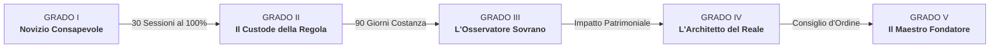

# 👑 BRAND AND LORE — Identità, Lessico e Gradi AUREUS

> «Consapevole che il mercato è uno specchio morale che punisce l'assenza di governo interiore, dichiaro di sottopormi volontariamente al protocollo AUREUS.»  
> — *La Dichiarazione del Patto*

Torna a: [[00-ATLAS]] | Precedente: [[01-OPERATIONAL-WORKFLOW]] | Prosegui a: [[03-FRONTEND-SYSTEM]]

---

## 1. Identità del Brand & Ethos Fondamentale

**AUREUS (AUREUS PROTOCOL / AUREUS OS)** non è una piattaforma di scommesse retail, né un videogioco arcade con punti XP. È un **Ordine Operativo e Spirituale** basato sul *Codice della Presenza e dell'Eredità*.

- **Motto Ufficiale**: *"Il Codice della Presenza e dell'Eredità"*
- **Titoli dei Membri**: *L'Iniziato*, *L'Operatore*, *L'Architetto*, *Il Maestro Fondatore*.
- **Tono di Voce**: Solenne, stoico, chirurgico, nobile, austero, architettonico.

---

## 2. Tabella di Corrispondenza Lessicale Inviolabile

È tassativamente vietato l'uso di terminologia retail, gergo da scommettitore, parole arcade o anglicismi generici quando esiste il termine d'Ordine:

| Termine Vietato (Retail / Gaming / Generico) | Termine Obbligatorio AUREUS | Note e Concetto Operativo |
| :--- | :--- | :--- |
| **TraderLoading / Limen (legacy)** | **AUREUS / AUREUS PROTOCOL** | Il nome sovrano dell'ecosistema e dell'OS |
| **Backtest / Simulatore** | **La Forgia del Passato / Banco di Forgiatura** | Luogo in cui la visione si affila nell'ombra prima della battaglia |
| **Trading Journal / Diario** | **Il Libro della Verità** | Registro spietato delle scelte e dell'integrità; i dati non mentono |
| **Checklist Pre-Trade / Filtro** | **Il Custode della Soglia** | Filtro decisionale severo: agisci per lucidità o per debolezza? |
| **Routine / Daily Tasks** | **L'Ordine Giornaliero** | Sequenza rituale e inviolabile; nessuna azione fuori dal protocollo |
| **Classifica / Leaderboard / Punti XP** | **La Gerarchia dell'Integrità / Indice di Integrità** | Il rango si conquista con la fedeltà al Codice, non si compra |
| **Tornei / Gare / Match** | **Le Prove del Fuoco / Arene della Disciplina** | Competizioni trimestrali di gestione del rischio e disciplina |
| **Profilo Utente / Impostazioni** | **Dossier dell'Operatore** | Registro storico del grado, dell'integrità e dei privilegi |
| **Social / Community / Canali** | **La Fratellanza (Agorà dell'Ordine)** | Confronto tra pari senza rumore, solo analisi e progresso |
| **Accademia / Video Corsi** | **La Dottrina del Tempo** | L'Arte dell'Assedio (Swing) e L'Arte del Duello (Scalp) |
| **Livelli di gioco (Lvl 1, 2, 3...)** | **I 5 Gradi di Ascesa** | I cinque ranghi d'Ordine basati su sessioni consecutive e integrità |
| **Utente / Scommettitore / Player** | **L'Operatore / L'Iniziato / L'Architetto** | Persona che governa se stessa e le proprie decisioni |
| **Tilt / Perdita emotiva / Gioco d'azzardo** | **La Deriva** | Condizione di chi è dominato dalle pulsioni interiori |
| **Dashboard / Home / Login riuscito** | **Il Varco (Centro di Comando)** | La soglia di passaggio dalla Deriva al governo conscio |
| **Merchandising / Shop / Store** | **L'Arsenale e L'Espansione** | Dotazioni fisiche e uniformi d'Ordine, sbloccate per merito |

---

## 3. I 5 Gradi di Ascesa (Meritocrazia Iniziatica)

Il sistema di avanzamento non premia il volume delle transazioni o la fortuna finanziaria, ma l'**Indice di Integrità** (%) e la costanza documentata ne *Il Libro della Verità*:

### Grado I — Novizio Consapevole
- **Sottotitolo**: *Ingresso nell'Ordine e addestramento ai fondamenti operativi.*
- **Requisito**: Sottoscrizione de *Il Patto di Ingresso alla Soglia di Selezione*.
- **Privilegi Sbloccati**: Accesso a La Forgia del Passato, La Dottrina del Tempo, L'Ordine Giornaliero, Il Custode della Soglia, Il Libro della Verità.
- **Limitazioni**: Mandato di Espansione (royalty 20%) bloccato.

### Grado II — Il Custode della Regola
- **Sottotitolo**: *Padronanza della disciplina quotidiana e diritto di trasmissione del Codice.*
- **Requisito**: 30 sessioni consecutive con Indice di Integrità al 100% ne *Il Libro della Verità* (minimo 85% complessivo).
- **Privilegi Sbloccati**: Sezione «Il Tempio Fisico» (protocollo biologico e nutrizionale), sblocco de «Il Mandato di Espansione» (Codice di Chiamata con royalty ricorrente del 20% — 30€/mese), accesso completo alle Prove del Fuoco d'Élite.

### Grado III — L'Osservatore Sovrano
- **Sottotitolo**: *Governo trimestrale del tempo, del corpo e dell'esecuzione.*
- **Requisito**: 90 giorni (1 trimestre) di costanza operativa e fisica verificata (integrità minima 90%).
- **Privilegi Sbloccati**: Accesso prioritario con diritto di parola a «Il Concilio della Domenica», moduli di negoziazione avanzata (Straight Line), accesso ai capi riservati de «L'Uniforme».

### Grado IV — L'Architetto del Reale
- **Sottotitolo**: *Trasmutazione della disciplina finanziaria in espansione imprenditoriale.*
- **Requisito**: 180 giorni di integrità superiore al 92% e certificazione di architettura patrimoniale personale.
- **Privilegi Sbloccati**: Accesso alla divisione Corporate/B2B e abilitazione come Docente d'Ordine.

### Grado V — Il Maestro Fondatore
- **Sottotitolo**: *Presidio della dottrina, custodia del fuoco e governo dell'Ecosistema.*
- **Requisito**: Riservato al consiglio direttivo e ai custodi fondatori.
- **Privilegi Sbloccati**: Potere di ammissione diretta, approvazione moduli dottrinali, emissione sigilli di eccellenza.

---

## 4. I Tre Pilastri del Manifesto AUREUS

1. **Uscita dalla Deriva**:
   Nessun ingresso impulsivo. Ogni esecuzione richiede *Contemplazione dello Scenario* (HTF), *Punto di Svolta* (ITF) e *Sigillo d'Azione* (M1).
2. **Il Libro della Verità**:
   Ogni sessione, vittoria o sconfitta viene registrata senza autoinganno. L'omissione equivale a cedimento morale.
3. **Meritocrazia d'Ordine**:
   Nessun privilegio si acquista con il denaro. L'accesso ai gradi superiori, all'uniforme e al mandato di espansione è vincolato all'Integrità verificata.
