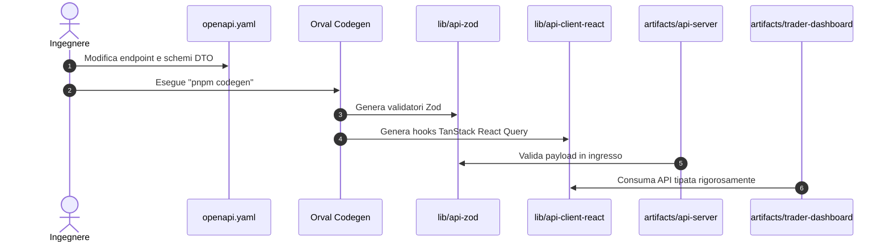

# 🛡️ BACKEND CONTRACTS — Architettura, Contratti & Persistenza

> [!IMPORTANT]
> **REGOLA ARCHITETTURALE**: Nessuna rotta o modello dati viene creato senza un contratto esplicito. Il file `lib/api-spec/openapi.yaml` è la sola e unica sorgente di verità. Tutti i client e gli schemi Zod derivano meccanicamente da esso tramite codegen.

Torna a: [[00-ATLAS]] | Precedente: [[03-FRONTEND-SYSTEM]] | Prosegui a: [[05-OPTIMIZATION-PERFORMANCE]]

---

## 1. Flusso di Sviluppo Contract-First



### Regole Rigide:
1. **Vietato Modificare i File Generati**: I file dentro `lib/api-zod/` e `lib/api-client-react/` sono sovrascritti automaticamente da Orval. Qualsiasi modifica manuale verrà spazzata via da `pnpm codegen`.
2. **Campi Nullabili in OpenAPI**: Usare la convenzione standard `oneOf: [$ref, { type: "null" }]` per gestire campi opzionali/nullabili in modo pulito con TypeScript.
3. **Query Keys Univoche**: Ogni nuovo endpoint di query generato da Orval richiede un'esplicita chiave univoca generata con `getGet<Op>QueryKey()`.

---

## 2. Isolamento Multi-Tenant per `userId`

Tutte le tabelle utente e le risorse private devono essere rigorosamente isolate a livello di database:

```typescript
// ESEMPIO DI QUERY CORRETTA (Sempre isolata per userId)
const userRecords = await db
  .select()
  .from(accountTradesTable)
  .where(
    and(
      eq(accountTradesTable.userId, req.auth.userId),
      eq(accountTradesTable.status, "closed")
    )
  );
```

> [!CAUTION]
> **Divieto Assoluto di Fidarsi del Client**: Non accettare mai `userId` dal body o dai query parameter per autorizzare una lettura o scrittura di dati privati. L'identità dell'utente deve provenire esclusivamente dal token Clerk verificato (`req.auth.userId`).

---

## 3. Transazionalità Finanziaria & Prevenzione TOCTOU

Nelle operazioni critiche (acquisto corsi, sblocco canali, bilanci, calcolo payout, mutazioni ordini):

1. **Locking con `pg_advisory_xact_lock`**:
   Per evitare doppi addebiti o corse critiche (Time-of-Check to Time-of-Use):
   ```typescript
   await db.transaction(async (tx) => {
     // Acquisisce un lock univoco per l'account durante la transazione
     await tx.execute(sql`SELECT pg_advisory_xact_lock(hashtext(${userId}))`);
     
     // Verifica saldo o autorizzazione e applica mutazione
   });
   ```
2. **Idempotenza nei Webhook di Pagamento**:
   Ogni webhook Stripe (`checkout.session.completed`, `customer.subscription.*`) deve verificare l'idempotenza tramite una tabella di eventi processati (`processed_stripe_events` o record immutabile con `stripe_event_id` unique).

---

## 4. Modello Monetizzazione: Stripe Connect Express

- **Zero Custodia Fondi**: La piattaforma non detiene fondi degli utenti e non funge da istituto di pagamento/moneta elettronica.
- **Flusso Marketplace**:
  - I canali a pagamento e i servizi dei creator vengono venduti tramite **Stripe Connect Destination Charges** o abbonamenti diretti.
  - La quota della piattaforma (`PLATFORM_FEE_BPS`) viene trattenuta direttamente all'origine da Stripe.
  - I fondi residui confluiscono direttamente sul conto connesso del creator.

---

## 5. Logging Strutturato con Pino & Gestione Errori

1. **Nessun Dato Sensibile nei Log**: È severamente vietato loggare token JWT, chiavi private, password o numeri di carta.
2. **Struttura dei Messaggi**:
   ```typescript
   logger.info({ userId, tradeId, action: "trade_sealed" }, "Operazione registrata ne Il Libro della Verità");
   ```
3. **Puntatori di Errore Client**: I dettagli interni del database non devono mai trapelare all'esterno. Ritornare codici di errore standardizzati (`INVALID_PAYLOAD`, `UNAUTHORIZED`, `ORDER_REJECTED`).
