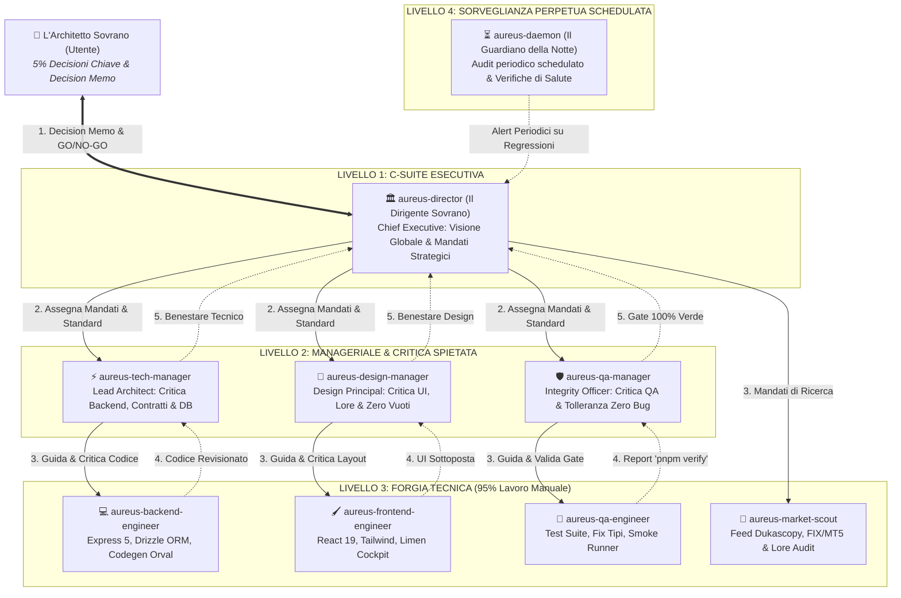

# 👑 MULTI-AGENT SYSTEM — Il Concilio Autonomo e la Regola 95/5

> «Un sovrano non scolpisce ogni pietra della cattedrale: traccia il perimetro, sceglie i maestri d'ascia e giudica l'opera finita.  
> Chi si perde nella polvere del cantiere dimentica dove sorge il cielo.  
> Nel Protocollo AUREUS, il 95% dell'energia è devoluto alla macchina esecutiva autonoma; il 5% è riservato al governo lucido e inappellabile dell'Architetto Sovrano.»  
> — *I Decreti della Forgia AUREUS*

Torna a: [[00-ATLAS]] | Correlati: [[01-OPERATIONAL-WORKFLOW]] | [[03-FRONTEND-SYSTEM]] | [[04-BACKEND-CONTRACTS]]

---

## 1. 🏛️ LA FILOSOFIA SOVRANA: LA REGOLA 95% / 5%

Il sistema multi-agente di AUREUS OS è stato progettato per risolvere la frizione operativa tipica dello sviluppo software su larga scala:
- **Il 95% (La Macchina Esecutiva)**: Scrittura manuale del codice, risoluzione di errori TypeScript strict, formattazione CSS con il Limen Design System, allineamento contratti OpenAPI 3.1, migrazioni Drizzle ORM, suite di test, benchmark di performance e audit del lessico stoico.
- **Il 5% (L'Architetto Sovrano - L'Utente)**: Visione strategica, prioritizzazione dei rilasci, arbitraggio tra trade-off architetturali e approvazione finale di rilascio tramite **Decision Memo chirurgici**.

---

## 2. 🗺️ ORGANIGRAMMA A 3 LIVELLI & GRAFO DELLE RESPONSABILITÀ



---

## 3. 👥 SCHEDE DEI RUOLI DEL CONCILIO

### Livello 1: C-Suite
- **`aureus-director` (Il Dirigente Sovrano)**:
  - Riceve gli input strategici dall'Utente.
  - Scompone le grandi epiche in compiti precisi per i tre Manager.
  - Redige i *5% Decision Memo* e filtra qualsiasi rumore o dettaglio banale.

### Livello 2: Manager di Linea (I Critici)
- **`aureus-tech-manager` (Lead Architect & Code Reviewer)**:
  - Fa code review spietata su `artifacts/api-server`, `lib/db` e `lib/api-spec`.
  - Blocca qualsiasi PR con query N+1, sprechi di egress Postgres, cast ad `any` o endpoint non conformi a OpenAPI.
- **`aureus-design-manager` (Design Principal & UX Critic)**:
  - Ispeziona ogni schermata di `artifacts/trader-dashboard`.
  - Applica senza pietà le regole di [[03-FRONTEND-SYSTEM]]: zero vuoti ingiustificati, zero muri di testo, `whitespace-nowrap` obbligatorio, font monospace per numeri finanziari, palette imperiale oro/ossidiana, zero tag di debug grezzi.
- **`aureus-qa-manager` (Integrity Officer & Gatekeeper)**:
  - Responsabile del gate assoluto di rilascio. Non consente il merge se `pnpm verify` o `pnpm smoke:runtime` falliscono anche solo di un millesimo.

### Livello 3: Ingegneri Esecutivi (95% Forza Lavoro)
- **`aureus-backend-engineer`**: Scrittura schemi Drizzle, endpoint Express, OpenAPI codegen, transazionalità e sicurezza multi-tenant.
- **`aureus-frontend-engineer`**: Creazione componenti React 19, interfacce reattive, grafici candlestick ad alte prestazioni, layout flessibili bilanciati.
- **`aureus-qa-engineer`**: Scrittura ed esecuzione dei test unitari e di integrazione, caccia e fix degli errori TypeScript.
- **`aureus-market-scout`**: Reverse engineering dati di mercato (Dukascopy, MT4/MT5), formule quantitative, controllo di conformità del lessico d'Ordine.

### Livello 4: Sorveglianza Perpetua Schedulata
- **`aureus-daemon`**: Attivato a intervalli ciclici tramite il tool nativo `schedule` di Antigravity per verificare salute del repo, drift e integrità del codice.

---

## 4. ⚖️ IL PROTOCOLLO DI CRITICA E REVISIONE SPIETATA

Nessun lavoro manuale eseguito dagli ingegneri passa direttamente all'Utente o in produzione. Ogni artefatto attraversa la **Camera di Critica Manageriale**:

1. **Critica di Architettura (Tech Review)**:
   - *Verifica*: Il contratto in `openapi.yaml` è stato aggiornato prima del codice? Le query sono isolate per `userId`? C'è rischio di race condition o TOCTOU?
   - *Esito*: Se fallisce, il Tech Manager rispedisce il codice all'ingegnere backend con note chirurgiche di rifacimento.
2. **Critica di Design & Lore (UX Review)**:
   - *Verifica*: Ci sono vuoti asimmetrici? C'è testo più lungo di 2 righe? Numeri e valute sono uniti con `whitespace-nowrap`? Ci sono badge brutti come `"DB"` o `"TEST"`? I termini rispettano il vocabolario d'Ordine?
   - *Esito*: Se fallisce, il Design Manager impone il refactoring immediato al frontend engineer.
3. **Critica di Integrità (QA Review)**:
   - *Verifica*: `pnpm typecheck` = 0? `pnpm test` = 0 errori? `pnpm smoke:runtime` = OK?
   - *Esito*: Se fallisce, il QA Manager blocca la pipeline.

---

## 5. 📋 IL FORMATO SOVRANO "5% DECISION MEMO"

Quando il Dirigente si rivolge all'Utente per una decisione di merito, adotta unicamente questo schema sintetico (tempo di lettura < 60 secondi):

```markdown
### 👑 Decisione Sovrana Richiesta: [Titolo dell'Operazione]
- **Sintesi Operativa**: [Massimo 2 righe sul contesto e la ragione della decisione].
- **Opzione Consigliata (A)**: [Descrizione della soluzione primaria con benefici e metriche].
- **Opzione Alternativa (B)**: [Descrizione dell'alternativa con trade-off chiaro].
- **Azione Immediata della Squadra**: [Cosa faranno i manager e gli ingegneri al tuo via].
```

---

## 6. 🛠️ COMANDI RAPIDI DEL CONCILIO NEL MONOREPO

Dalla radice del monorepo sono disponibili i seguenti comandi dedicati:

```bash
# 1. Ispezione stato della squadra e salute generale del repo
pnpm council

# 2. Gate di verifica gestito dalla Sentinella di QA
pnpm council:verify

# 3. Rassegna critica simulata dei Manager (Architettura, Design, Integrità)
pnpm council:critique

# 4. Avvio guardia perpetua del daemon (modalità watch)
pnpm council:watch
```

---

## 7. 🚀 INTEGRAZIONE CON I COMANDI SLASH DI ANTIGRAVITY

- **/plan**: Richiede al Dirigente e ai Manager di strutturare un'analisi approfondita e un piano di battaglia prima di toccare il codice.
- **/teamwork**: Attiva la cooperazione simultanea tra i subagenti del concilio per affrontare task complessi su larga scala.
- **/goal**: Mette la squadra in modalità autonoma continua senza interruzioni fino al raggiungimento completo dell'obiettivo e superamento del gate.
- **/schedule**: Imposta routine ricorrenti di monitoraggio e audit da parte di `aureus-daemon`.
