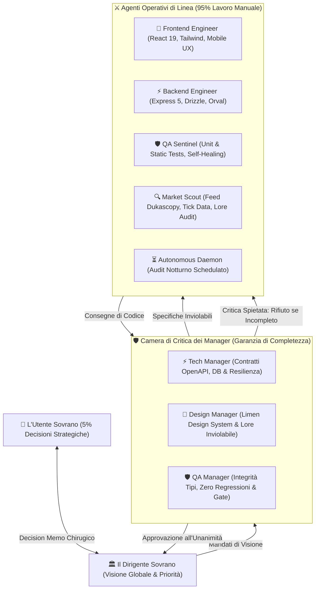

# 🏛️ SOVEREIGN MEMORY MATRIX — Stato dell'Unione, Visione & Benchmark Globale

> «La lucidità non è assenza di complessità, ma padronanza geometrica del contesto. Chi non ricorda dove si trova, non può decidere dove andare.»  
> — *I Canoni del Consiglio Direttivo AUREUS*

Questa nota costituisce la **memoria stabile, incorruttibile e ad alta densità** del progetto **AUREUS OS (AUREUS PROTOCOL)**.  
È il punto di riferimento unico per sapere istantaneamente da dove procedere, quale sia la gerarchia decisionale, quali siano i benchmark industriali di riferimento e quale sia lo stato esatto del monorepo.

---

## 🧭 1. STATO DELL'UNIONE (Snapshot Operativo Attivo)

| Dimensione | Stato Verificato | Dettaglio Tecnico & Garanzia |
| :--- | :---: | :--- |
| **Suite di Collaudo** | `572 / 572 PASS (100%)` | Zero fallimenti su api-server, trader-dashboard, api-zod, db, scripts |
| **Typecheck Strict** | `0 ERRORI` | Compilazione TypeScript rigorosa `tsc --build --force` immacolata |
| **Camera dei Manager (`council:critique`)** | `APPROVATO CON LODE` | Design Manager, Tech Manager e QA Manager concordi |
| **Guardiano della Notte (`aureus-daemon`)** | `ATTIVO & VIGILE` | Cron job schedulato in background con audit periodico automatico |
| **Navigazione Mobile & Desktop** | `COMPLETA & ELEVATA` | Nuova Sovereign Dock bar, alone dorato, drawer monastico, safe-area iOS |
| **Cockpit Operativo (Il Varco)** | `FLUIDO & BIDIREZIONALE` | Mobile Flow Ribbon con fase e bias in vista Grafico, zero cecità operativa |
| **Il Libro della Verità (Journal)** | `TELEMETRIA ATTIVA` | Mobile Sovereign Telemetry Ribbon (Win Rate, PF, Integrità, Bio-Coerenza) |
| **Risuonatore & Motore Aptico** | `SINESTESIA 432 HZ ATTIVA` | Risonanza armonica sacra a 432 Hz, doppio impulso aptico mobile per validazioni checklist Custode della Soglia, feedback swipe inerziale e cinema mode snap |
| **PWA Standalone & Fullscreen** | `NATIVO ADERENTE AL 100%` | Manifest con `display: standalone`, `orientation: any`, rimozione barre browser, splash screen ossidiana, 4 scorciatoie operative e hook `usePwaStandalone` |
| **Audio Spaziale 3D & Stereo Panning** | `STEREOFONIA PROCEDURALE ATTIVA` | Panning direzionale 3D via `StereoPannerNode` su Web Audio API: SSL a sinistra (-0.75, discesa tellurica 216→108Hz + sub 54Hz) e BSL a destra (+0.75, ascesa aurea 432→864Hz + shimmer 1296Hz), integrato in `SessionOpensOverlay`, `TradingCockpit` e `SoundFxSettings` |
| **Auto-Landscape Pivot & Fullscreen Cinema** | `ATTIVO & ERGONOMICO (100% PASS)` | Hook `useAutoLandscapeCinema` con media query 640px e ScreenOrientation API nativa; dual-thumb HUD separato (sinistra telemetria, destra operatività) in Cockpit e Forgia con safe-area notch iOS |
| **Gesture Swipe Inerziale Tattile & Bezel Edge** | `TRI-FASE ATTIVA (100% PASS)` | Rilevamento swipe bezel edge (<=36px) su canvas grafico; navigazione fluida 3-stati (Processo ↔ Grafico ↔ Custode della Soglia) con audio/aptica `synestheticSwipe()` e affordance visive pulsanti |
| **Quick Order Drawer Laterale (Forgia Rapida)** | `ATTIVO & BIO-LOCK INTEGRATO` | Drawer laterale a comparsa da destra per esecuzione rapida Buy/Sell, preset R:R (1:1, 1:2, 1:3, 1:5), chip rischio %, stepper pips SL/TP, gestione posizioni attive (Tutte a BE, Chiudi Tutte) e swipe-to-dismiss |
| **LimenResponsiveDrawer (Adaptive Bottom Sheet)** | `UNIVERSALE MOBILE & DESKTOP` | Sostituzione dei modali centrati su mobile con Bottom Sheets ergonomici (side="bottom", drag handle, swipe-down to dismiss, safe-area iOS) e Dialog imperiale su desktop |
| **Mobile Journal Trade Ledger** | `LISTA COMPATTA & ZERO SCROLL` | Eliminazione dello scroll infinito da 5000px su mobile; lista compatta luxury-broker a righe monospace, nastro KPI (Win Rate, Trade, P&L) e apertura dossier in Bottom Sheet |
| **Lessico & Lore AUREUS** | `MONASTICO & STOICO` | Bonifica totale di gergo retail in `dict.it.ts`, Leaderboard e Cockpit |
| **Compilazione Vite & Prerender** | `75 / 75 ROUTES OK` | Build SSR/SSG di produzione impeccabile con sitemap generata |
| **Protocollo di Autonomia Agentica** | `REGOLA 98/2 ATTIVA` | Calcolo autonomo step-by-step, compattazione chirurgica dati, zero interruzioni futili |

---

## 🏛️ 2. GERARCHIA TRIPARTITA: VISIONE, CRITICA & ESECUZIONE

L'ecosistema opera secondo la **Regola del 95/5**: il 95% del lavoro manuale (codice, bugfix, typecheck, layout responsive, test) è svolto in autonomia dal Concilio Agenti; l'Utente Sovrano prende solo il 5% delle decisioni chiave tramite **Decision Memos**.

### Ruoli Inviolabili:
1. **I Dirigenti (Visione)**:
   - Fissano l'orizzonte strategico, l'identità del brand e il valore differenziante nel mercato istituzionale.
   - Non scrivono sintassi né dettagli di basso livello; comunicano con Decision Memos sintetici.
2. **I Manager (Completezza & Rigore Spietato)**:
   - **Non accettano lavori a metà o frettolosi**.
   - Se un componente mobile ha un testo che va a capo male, il Design Manager blocca il rilascio.
   - Se un endpoint non rispetta `openapi.yaml` o manca di multi-tenant isolation, il Tech Manager ordina il refactoring.
   - Se un test fallisce o il typecheck non è a zero errori, il QA Manager serra il gate di rilascio.
3. **Gli Agenti Operativi (Esecuzione Continua)**:
   - Scrivono il codice, eseguono i refactoring, creano i componenti e i test, eseguono i comandi di verifica.

---

## 🏆 3. BENCHMARK COMPARATIVO CON I TOP SOFTWARE MONDIALI

Per rendere AUREUS un'opera d'arte del software, il Concilio misura costantemente ogni componente contro i massimi standard mondiali di design, velocità ed ergonomia:

| Piattaforma di Riferimento | Benchmark d'Eccellenza | Dove AUREUS Pareggia o Supera lo Standard |
| :--- | :--- | :--- |
| **TradingView** | Fluidità candele Canvas/WebGL, timeframes istantanei, strumenti di disegno e crosshair magnetico su mobile/desktop. | AUREUS adotta Lightweight Charts v5 potenziato, ma **supera TradingView** integrando il motore di Replay con Tick Reali proprietario, la correlazione delle liquidità istituzionali (*Session Opens Overlay*) e il log del trade direttamente agganciato al frame temporale senza uscire dalla vista. |
| **Linear & Raycast** | Perfezione delle micro-interazioni, shortcut da tastiera (`[`, `⌘B`), transizioni a molla (spring physics), tema scuro Ossidiana e contrasto dorato privo di sbavature. | AUREUS implementa la stessa filosofia: scorciatoie da tastiera native per collassare la sidebar o aprire i respiri tattici (`B` per Respiro, `D` per Decompressione), haptic pulses, zero ricaricamenti di pagina e una suite di icone e stemmi nobili esclusivi. |
| **Bloomberg Terminal / FactSet** | Densità chirurgica delle informazioni, zero pixel morti, tipografia finanziaria rigorosa in monospace, telemetrie di sessione e orari di mercato in tempo reale. | AUREUS adotta font `font-mono tracking-tight` su ogni cifra e valuta, layout `flex-stretch` bilanciati per evitare gradini asimmetrici, telemetria di mercato 3D (*La Sfera dei Mercati*) e monitoraggio costante di P&L, Win Rate e Drawdown senza sacrificare l'eleganza estetica. |
| **TradeZella & Edgewonk** | Diario di trading analitico, equity curve cumulativa, metriche statistiche e filtri per tag emotivi (FOMO, Revenge). | **AUREUS demolisce TradeZella ed Edgewonk**: dove loro sono semplici fogli di calcolo passivi compilati a posteriori, AUREUS offre **Il Varco** (esecuzione guidata pre-trade per impedire la deviazione prima che avvenga), la **Curva Zero-Leak** (che calcola matematicamente il capitale reale escludendo i trade impulsivi) e l'analisi **Bio-Tension** integrata con smartwatch e battito cardiaco. |
| **Bookmap & TradingLite** | Mappe termiche di liquidità, ordini iceberg e tracciamento dello sweep dei livelli di apertura di sessione. | AUREUS integra la telemetria di sessione e gli allarmi sweep (`SESSION_SWEEP_ALERT_EVENT`) direttamente nel terminale della Forgia del Passato, avvisando l'Operatore delle prese di liquidità Asia/Londra/NY. |

---

## 🛠️ 4. STRUMENTI & SKILL SET DI SVILUPPO D'ECCELLENZA

Per garantire lo sviluppo frontend e full-stack ai massimi livelli di settore, il Concilio si avvale di:

1. **Skill Native Integrate**:
   - `frontend-design`: Creazione di interfacce production-grade con estetica non generica e finiture d'élite.
   - `ui-ux-pro-max`: Intelligenza avanzata con 50+ stili, 161 palette, 25 tipi di grafici e 99 linee guida UX per mobile/desktop.
   - `chrome-devtools` & `a11y-debugging`: Ispezione DOM, viewport mobile audit, Core Web Vitals e accessibilità.
   - `neon` suite (`neon-postgres`, `neon-auth`): Architettura cloud serverless con branching e query tuning.
2. **Estensioni Consigliate (Agent Marketplace)**:
   - `antigravity-plugins-partners/plugin/mobbin`: Archivio di oltre 600.000 schermate di app reali da cui estrarre pattern UX di riferimento (TradingView, Revolut, Linear).
   - `antigravity-plugins-partners/plugin/figma`: Conversione istantanea di mockup ad alta fedeltà in codice Tailwind/React.

---

## 🎯 5. FRONTIERA ATTIVA & PROSSIMI PASSI STRATEGICI

1. **Auto-Landscape Pivot su Mobile**:
   Quando l'Operatore ruota il telefono in orizzontale, la vista del Grafico nel Cockpit e nella Forgia deve aprirsi automaticamente a tutto schermo (Fullscreen TradingView-like) senza bordi di navigazione, posizionando i controlli di playback sul pollice destro.
2. **Gesture Swipe Tattili (Checklist ↔ Grafico)**:
   Abilitare lo swipe orizzontale inerziale su mobile per scivolare istantaneamente dal Processo al Grafico.
3. **Sincronizzazione Internazionale Lore**:
   Allineare i dizionari `dict.en.ts`, `dict.es.ts`, `dict.fr.ts` e `dict.de.ts` al lessico AUREUS (*The Forge of the Past*, *The Book of Truth*, *The Threshold*).
4. **Consolidamento Git**:
   Mantenere un albero git tracciato con commit atomici a ogni traguardo verificato.
