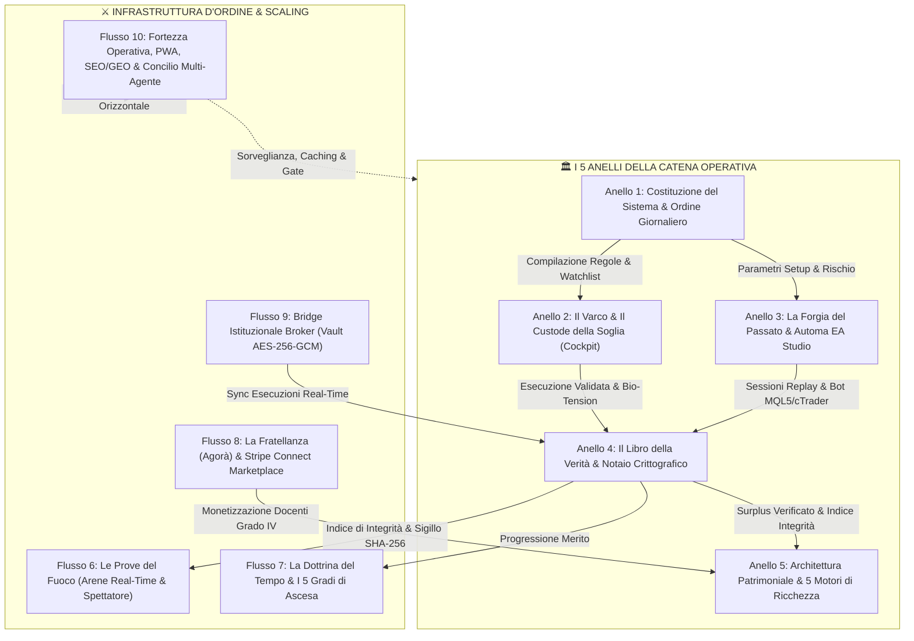
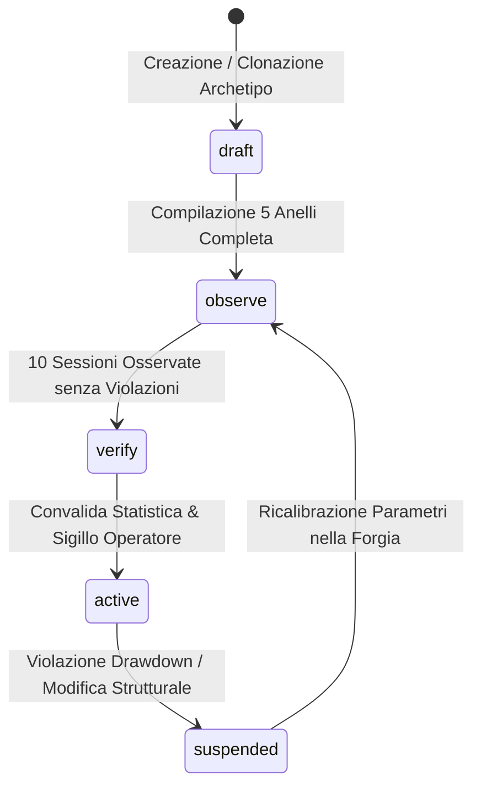
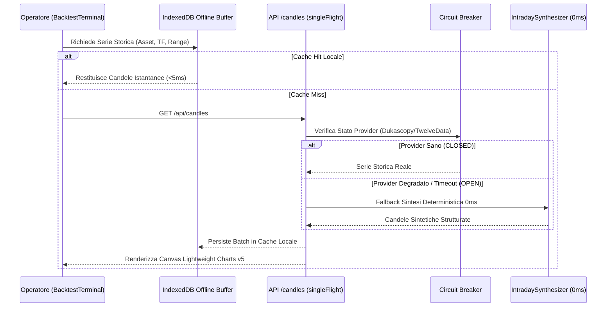
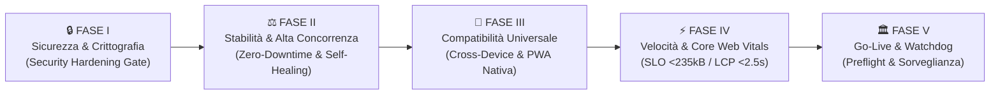

# 🏛️ DEEP SYSTEMS & PUBLIC LAUNCH ROADMAP — I 10 Anelli Sovrani & Protocollo di Go-Live

> «Un'architettura che sopravvive solo in assenza di tempesta è un simulacro. L'Ordine AUREUS è forgiato per dominare il picco, blindare il capitale e custodire la verità crittografica dell'Operatore.»  
> — *Il Codice degli Architetti Sovrani*

Questo documento costituisce la **mappa architetturale profonda dei 10 Flussi Sistemici (Deep System Flows)** di **AUREUS OS (AUREUS PROTOCOL)** e codifica la **Master Roadmap di Lancio Pubblico** articolata sui 4 pilastri inviolabili: **Sicurezza, Stabilità, Compatibilità e Velocità**.

---

## 🗺️ PARTE I: MAPPATURA ARCHITETTURALE DEI 10 FLUSSI SISTEMICI (DEEP SYSTEM FLOWS)



---

### 1. Anello 1 — La Costituzione del Sistema & L'Ordine Giornaliero

Governa la codifica formale del metodo operativo e la sequenza rituale giornaliera prima dell'esposizione al mercato.

- **File Chiave**:
  - Frontend: `artifacts/trader-dashboard/src/pages/Method.tsx`, `MobileChainWizard.tsx`, `SystemCompilationTutorialModal.tsx`, `DailyOrderStageCard.tsx`
  - Backend: `artifacts/api-server/src/routes/traderProcess.ts`, `lib/db/src/schema/traderProcess.ts`
- **Architettura & State Machine**:
  - **Compilatore a 5 Anelli (5-Ring System Compiler)**: Guida l'Operatore nella definizione strutturata di *Contesto Macro/Sessione*, *Setup & Trigger*, *Rischio & Invalidazione*, *Gestione Posizione* e *Protocollo Post-Trade*.
  - **3 Archetipi Istituzionali Pre-Calibrati**: Template d'élite (*SMC Liquidity Sweep*, *Session Breakout London/NY*, *Mean Reversion VWAP Institutional*) iniettabili con un tap.
  - **Ordine Giornaliero Mobile a 4 Stadi**: Flusso sequenziale guidato (*Preparazione Mente & Bio* → *Scansione Orizzonte* → *Allineamento Watchlist* → *Sigillo Pre-Sessione*).
  - **Ciclo di Vita Rigoroso**: Macchina a stati deterministica `draft` → `observe` → `verify` → `active` → `suspended`.
- **Invarianti & Protezioni Failure-Mode**:
  - **Isolamento Multi-Tenant**: Ogni regola, sistema e checklist è vincolato a `eq(table.userId, req.auth.userId)`.
  - **Prevenzione Deriva Metodologica**: Impossibile attivare (`active`) un sistema privo di parametri di rischio massimo giornaliero o regole di invalidazione esplicite.



---

### 2. Anello 2 — Il Varco & Il Custode della Soglia (Cockpit Operativo)

Il filtro decisionale pre-trade e il centro di comando real-time che impedisce l'ingresso impulsivo (*La Deriva*) prima che l'ordine raggiunga il mercato.

- **File Chiave**:
  - Frontend: `artifacts/trader-dashboard/src/pages/TradingCockpit.tsx`, `lib/propGuardian.ts`, `lib/smartwatchBle.ts`, `hooks/useAutoLandscapeCinema.ts`
  - Backend: `artifacts/api-server/src/routes/cockpitProtocol.ts`
- **Architettura & Capacità**:
  - **Gate del Custode della Soglia**: Checklist pre-trade bloccante con validazione sinestetica a `432 Hz` e doppio impulso aptico.
  - **Bio-Tension BLE Heart-Rate Monitor**: Connessione Web Bluetooth (`smartwatchBle.ts`) a fasce cardio/smartwatch per rilevare picchi tachicardici da stress o FOMO.
  - **Prop Firm Drawdown Shield (`propGuardian.ts`)**: Scudo matematico sui limiti istituzionali (`5% Daily Drawdown` / `10% Max Total Drawdown`). Al raggiungimento del **75% del budget di rischio giornaliero**, attiva automaticamente il **Bio-Lock** (blocco esecutivo e dimezzamento forzato della leva).
  - **1-Tap Adaptive Lot Sizing & Export**: Calcolo istantaneo del lotto esatto in base a SL (pips), saldo e `% rischio`, con esportazione diretta del payload per **MT5 / cTrader**.
  - **Ergonomia Mobile Tri-Fase**: Navigazione bezel-edge swipe (`<= 36px`) a 3 stati (`Processo ↔ Grafico ↔ Custode della Soglia`) e **Audio Spaziale 3D** (`StereoPannerNode`: Sell-Side Liquidity Sweep a sinistra `-0.75` a `216→108Hz`, Buy-Side Liquidity Sweep a destra `+0.75` a `432→864Hz`).
- **Invarianti & Protezioni Failure-Mode**:
  - **Fail-Safe Bio-Lock**: Se il sensore BLE si disconnette durante una fase di stress elevato, il sistema mantiene l'ultimo stato di cautela senza resettare i vincoli di rischio.
  - **Zero-Math Drift**: Tutte le formule di position sizing gestiscono i valori pip per Forex, Indici, Metalli (XAUUSD) e Crypto senza errori di arrotondamento floating-point.

---

### 3. Anello 3 — La Forgia del Passato & L'Automa della Forgia (EA Studio)

Simulatore storico ad altissima precisione per l'affilatura della visione e studio di ingegneria algoritmica *Concept-to-Bot*.

- **File Chiave**:
  - Frontend: `artifacts/trader-dashboard/src/pages/Backtest.tsx`, `BacktestTerminal.tsx`, `QuickOrderDrawer.tsx`, `lib/eaForgeEngine.ts`
  - Backend: `artifacts/api-server/src/routes/candles.ts`, `services/intradaySynthesizer.ts`
- **Architettura & Capacità**:
  - **Motore Candele Multi-Tier & Sintesi 0ms**:
    1. *Tier 1 (0ms Local & Deterministic Synthesis)*: `intradaySynthesizer.ts` genera micro-strutture intraday realistiche coerenti con OHLC giornalieri/orari quando i feed esterni sono offline o fuori range.
    2. *Tier 2 (Institutional & Market Feeds)*: Dukascopy (tick/M1 storici), TwelveData, Yahoo Finance, Binance.
    3. *Tier 3 (Resilience Layer)*: Deduplicazione `singleFlight` contro thundering herd, **Circuit Breaker a 3 stati** (`CLOSED`, `OPEN`, `HALF_OPEN`) e buffer offline **IndexedDB** lato client.
  - **Replay Bar-by-Bar & Order Flow Footprint**: Avanzamento tick/candela, `QuickOrderDrawer` laterale con preset R:R (`1:1`, `1:2`, `1:3`, `1:5`), parziali, Break-Even in un tap e **Talk-to-Journal** (dettatura vocale/testuale istantanea ancorata al timestamp della candela).
  - **L'Automa della Forgia (`eaForgeEngine.ts`)**: Studio *Concept-to-Bot* che trasforma le regole de *Il Metodo* in codice compilabile **MQL5 (MetaTrader 5)** e **cTrader Automate (C# cBot)**, corredato da casi studio storici verificati (riservato ai sottoscrittori del piano **150€**).
- **Invarianti & Protezioni Failure-Mode**:
  - **Anti-Lookahead Bias**: Il motore di replay tronca rigorosamente l'array di candele future al timestamp corrente della simulazione; nessun indicatore o footprint può leggere oltre il cursore `currentReplayIndex`.
  - **Bounded Memory Cache**: Cache LRU server-side limitata a `5.000` chiavi per prevenire saturazione RAM sotto carico multi-utente.



---

### 4. Anello 4 — Il Libro della Verità & Notaio Crittografico

Registro incorruttibile delle esecuzioni, analisi comportamentale e certificazione crittografica pubblica dell'onore operativo.

- **File Chiave**:
  - Frontend: `artifacts/trader-dashboard/src/pages/Journal.tsx`, `SovereignJournalCockpit.tsx`, `MobileJournalTradeList.tsx`, `IntegrityConfessorModal.tsx`, `lib/notaryScrollGenerator.ts`, `workers/monteCarlo.worker.ts`
  - Backend: `artifacts/api-server/src/routes/journal.ts`, `routes/honorCardVerification.ts`
- **Architettura & Capacità**:
  - **Curva Zero-Leak (Zero-Leak Equity Curve)**: Sovrappone la curva di capitale reale alla curva teorica ottenuta rimuovendo matematicamente i trade eseguiti in violazione del Custode della Soglia (*La Deriva*), quantificando in valuta il costo esatto dell'indisciplina.
  - **Virtue Radar & Correlazione Bio-Tension**: Mappa esagonale delle virtù operative (Pazienza, Esecuzione, Rischio, Postura Bio, Fedeltà al Setup, Gestione Uscita) incrociata coi BPM registrati.
  - **Notaio Crittografico & Sigillo SHA-256**: Genera attestati con hash crittografico deterministico (`SHA-256`) verificabili pubblicamente senza login sulla rotta `/verify/:hash`.
  - **Simulazione Monte Carlo in Web Worker**: Calcola `1.000+` traiettorie stocastiche di equity e rischio di rovina in un thread dedicato senza bloccare il main thread UI (`0ms UI jank`).
- **Invarianti & Protezioni Failure-Mode**:
  - **Immutabilità del Sigillo**: Qualsiasi alterazione retroattiva di un trade sigillato invalida l'hash SHA-256 e revoca la verifica pubblica.

---

### 5. Anello 5 — Architettura Patrimoniale & I 5 Motori di Ricchezza

Trasforma i profitti estratti dal mercato in patrimonio sovrano intergenerazionale.

- **File Chiave**:
  - Frontend: `artifacts/trader-dashboard/src/pages/FinancialArchitecture.tsx`, `PropFirmCalculatorModal.tsx`, `TaxDoctrineModal.tsx`
  - Backend: `artifacts/api-server/src/routes/financialProfileApi.ts`
- **Architettura & Capacità**:
  - **I 5 Motori di Ricchezza**: Ripartizione strutturata tra *Liquidità di Riserva (Fortezza)*, *Capitale Operativo & Prop Scaling*, *Asset Reali & Rendita*, *Asimmetria Strategica* e *Tesoreria Fiscale*.
  - **Protocollo di Drenaggio del Surplus**: Regole automatiche di prelievo periodico dal conto trading verso gli asset patrimoniali a basso rischio.
  - **Calcolatore Prop Firm & Dottrina Fiscale**: Modellazione del ritorno sull'investimento delle challenge Prop e accantonamento fiscale preventivo.
- **Invarianti & Protezioni Failure-Mode**:
  - **Validazione Somma Allocazioni**: I pesi percentuali di allocazione del surplus sono validati via schema Zod per garantire consistenza contabile (`100%` totale senza perdite di precisione).

---

### 6. Le Prove del Fuoco (Arene della Disciplina) & Spettatore Pubblico

Competizioni di integrità e gestione del rischio in tempo reale, dove il merito prevale sul volume d'azzardo.

- **File Chiave**:
  - Frontend: `artifacts/trader-dashboard/src/pages/Tornei.tsx`, `ArenaView.tsx`, `PublicArenaSpectatorPage.tsx`
  - Backend: `artifacts/api-server/src/routes/tournaments.ts`, `routes/standings.ts`, `routes/prizes.ts`
- **Architettura & Capacità**:
  - **Stanze Real-Time Multi-Nodo**: Sincronizzazione istantanea di ordini, drawdown e classifiche tramite **WebSockets + Redis Pub/Sub**.
  - **Modalità Spettatore Pubblico (`PublicArenaSpectatorPage.tsx`)**: Telemetria live delle sfide con curve di equità comparative senza esporre i segreti strategici privati finché il match è in corso.
  - **Orphan Room Sweeper**: Job periodico di pulizia che chiude e archivia le stanze inattive, liberando descrittori di socket e memoria.
- **Invarianti & Protezioni Failure-Mode**:
  - **Squalifica Deterministica Immediata**: Il superamento del drawdown massimo della stanza (`es. 10%`) innesca la liquidazione automatica e il blocco dell'operatività del partecipante.
  - **Assegnazione Premi Atomica**: Transazioni protette da `pg_advisory_xact_lock` per impedire doppi accrediti in caso di chiusure simultanee.

---

### 7. La Dottrina del Tempo & I 5 Gradi di Ascesa

Il percorso iniziatico di studio, verifica sapienziale e progressione meritocratica nell'Ordine.

- **File Chiave**:
  - Frontend: `artifacts/trader-dashboard/src/pages/Academy.tsx`, `Milestones.tsx`, `DoctrineExamModal.tsx`
  - Backend: `artifacts/api-server/src/routes/academy.ts`, `contracts/limenGrades.ts`
- **Architettura & Capacità**:
  - **Lettore Tablet dei 3 Libri Sovrani**: Consultazione immersiva dei testi fondativi (*L'Arte dell'Assedio*, *L'Arte del Duello*, *Il Codice della Presenza*).
  - **Streaming Video Blindato**: Erogazione lezioni tramite **Cloudflare Stream con URL firmati crittograficamente (TTL massimo 3 ore)**.
  - **I 5 Gradi di Ascesa**: Progressione vincolata all'**Indice di Integrità** (*Novizio Consapevole* → *Custode della Regola [30gg 100%]* → *Osservatore Sovrano [90gg]* → *Architetto del Reale [180gg]* → *Maestro Fondatore*).
- **Invarianti & Protezioni Failure-Mode**:
  - **Il Rango Non Si Compra**: Nessun pagamento può sbloccare un Grado superiore senza aver soddisfatto i requisiti matematici di sessioni consecutive nel Libro della Verità e superato l'esame dottrinale (`DoctrineExamModal`).

---

### 8. La Fratellanza (Agorà dell'Ordine) & Marketplace Stripe Connect

Comunicazione ad alto segnale filtrata per rango e infrastruttura di monetizzazione disintermediata per gli Architetti.

- **File Chiave**:
  - Frontend: `artifacts/trader-dashboard/src/pages/Chat.tsx`, `ConversationsWorkspace.tsx`
  - Backend: `artifacts/api-server/src/routes/billing.ts`, `routes/channelAccess.ts`
- **Architettura & Capacità**:
  - **Canali Protetti da ACL di Grado**: L'accesso di lettura/scrittura ai canali dell'Agorà e alle stanze vocali WebRTC è governato dal Grado di Ascesa dell'Operatore.
  - **Stripe Connect Express Marketplace**: Pagamenti diretti (*Destination Charges*) con split automatico delle commissioni senza che la piattaforma detenga custodia di fondi terzi.
- **Invarianti & Protezioni Failure-Mode**:
  - **Idempotenza Assoluta dei Webhook**: Ogni evento Stripe viene registrato per `stripe_event_id` dentro una transazione con `pg_advisory_xact_lock(hashtext(userId))` per azzerare il rischio di race condition (TOCTOU) o doppi sblocchi.

---

### 9. Bridge Istituzionale Broker (MT4 / MT5 / cTrader / FX Blue / SnapTrade)

Sincronizzazione bidirezionale sicura tra i terminali di esecuzione istituzionali e l'ecosistema AUREUS.

- **File Chiave**:
  - Frontend: `artifacts/trader-dashboard/src/pages/Broker.tsx`, `AccountBridgeWorkspace.tsx`
  - Backend: `artifacts/api-server/src/routes/broker.ts`, `services/brokerHub/`
- **Architettura & Capacità**:
  - **Vault Crittografico AES-256-GCM**: Tutte le credenziali, token OAuth e chiavi di connessione broker sono cifrate a riposo con `BROKER_VAULT_KEY` (IV univoco e Auth Tag verificato a ogni decifratura).
  - **Connettori Multi-Protocollo**: Sync via EA Bridge nativo (WebSocket/REST tokenizzato), cTrader Open API, FX Blue e SnapTrade.
- **Invarianti & Protezioni Failure-Mode**:
  - **Zero Plaintext Secrets in Logs/DB**: I segreti broker non transitano mai in chiaro nei log di Pino né nelle risposte API verso il client (mascheramento automatico).

---

### 10. Fortezza Operativa, PWA Nativa, SEO/GEO & Autonomia Multi-Agente

L'infrastruttura di resilienza, distribuzione globale, posizionamento organico/AI e auto-guarigione del monorepo.

- **File Chiave**:
  - Infrastruttura & Script: `scripts/local/productionPreflight.ts`, `scripts/local/verify.ts`, `scripts/local/council.ts`
  - Frontend & Runtime: `artifacts/trader-dashboard/src/lib/pwaAutoUpdater.ts`, `lib/semAttribution.ts`, `artifacts/api-server/src/services/systemMaintenance.ts`
- **Architettura & Capacità**:
  - **75 Rotte Prerenderizzate (SSR/SSG) & GEO/AI Search Attribution**: Generazione statica delle pagine pubbliche, JSON-LD strutturato, `sitemap.xml` e tracciamento dell'attribuzione da motori generativi (ChatGPT, Perplexity, Claude, Gemini) e campagne SEM.
  - **PWA Standalone & Auto-Updater Silenzioso**: Esperienza nativa a tutto schermo su iOS/Android/Desktop con aggiornamento atomico dei Service Worker senza schermate bianche per chunk scaduti.
  - **Scaling Orizzontale per Ruolo (`SERVICE_ROLE`)**: Il backend può essere istanziato come `all`, `api` (stateless REST), `gateway` (WebSockets/Realtime) o `worker` (cron/sweeper/maintenance).
  - **Concilio Multi-Agente Autonomo (Regola 98/2)**: Sorveglianza continua tramite `pnpm council:daemon`, compattazione della memoria e Session Rail (`pnpm council:sessions`).

---

## 🚀 PARTE II: MASTER ROADMAP DI LANCIO PUBBLICO (GO-LIVE PROTOCOL)

> [!IMPORTANT]
> **I 4 PILASTRI DEL RILASCIO SOVRANO**:
> Il lancio pubblico di AUREUS OS è governato da metriche ingegneristiche verificabili su **Sicurezza, Stabilità, Compatibilità e Velocità**. Nessuna fase può essere aggirata.



---

### 🔒 FASE I — Blindatura Crittografica & Sicurezza (Security Hardening Gate)

Obiettivo: Garantire isolamento multi-tenant ermetico, protezione crittografica dei segreti e conformità normativa totale prima dell'apertura al traffico pubblico.

| Area di Blindatura | Requisito Tecnico & Invariante di Produzione | Strumento / File di Verifica | Stato |
| :--- | :--- | :--- | :---: |
| **Vault Broker AES-256-GCM** | Chiave `BROKER_VAULT_KEY` a 32 byte (256-bit) ad alta entropia; IV a 12 byte e AuthTag a 16 byte verificati ad ogni lettura. | `scripts/local/productionPreflight.ts` | ✅ VERIFICATO |
| **Autenticazione Clerk Produzione** | Chiavi `pk_live_` / `sk_live_` attive; `VITE_CLERK_PROXY_URL` disattivato per prevenire black-screen e rischi MITM; JWT validato su ogni rotta privata. | `artifacts/api-server/src/middleware/auth.ts` | ✅ VERIFICATO |
| **Isolamento Multi-Tenant (`userId`)** | 100% delle query Drizzle su dati privati filtrate con `eq(table.userId, req.auth.userId)`. Zero fiducia nei parametri client. | Audit `04-BACKEND-CONTRACTS` | ✅ VERIFICATO |
| **Validazione Input & Upload** | Validazione `Zod.safeParse` su tutti i body/query; ispezione magic bytes per verificare il MIME reale degli upload; URL firmati Cloudflare Stream (TTL 3h). | `artifacts/api-server/src/routes/` | ✅ VERIFICATO |
| **Diritto all'Oblio GDPR** | Cancellazione atomica a cascata di tutti i dati dell'Operatore (trade, journal, arene, chat, allegati, profili finanziari). | `accountDeletion.ts` | ✅ VERIFICATO |
| **Protezione Webhook & CSRF/CORS** | Verifica firma crittografica `STRIPE_WEBHOOK_SECRET` e `CLERK_WEBHOOK_SECRET`; CORS ristretto al dominio canonico `APP_BASE_URL`. | `routes/billing.ts`, `app.ts` | ✅ VERIFICATO |

---

### ⚖️ FASE II — Stabilità Transazionale & Resilienza Alta Concorrenza (Zero-Downtime & Self-Healing)

Obiettivo: Resistere a picchi improvvisi di traffico simultaneo (es. apertura sessione New York o lancio Prove del Fuoco) con zero corruzione dati e degradazione aggraziata.

| Meccanismo di Resilienza | Configurazione & Soglia Operativa | Impatto sul Sistema | Stato |
| :--- | :--- | :--- | :---: |
| **Advisory Locks Finanziari** | `SELECT pg_advisory_xact_lock(hashtext(userId))` su fatturazione Stripe, iscrizioni Arene, premi e sblocco canali. | Zero race condition (TOCTOU) e zero doppi addebiti/accrediti. | ✅ ATTIVO |
| **Circuit Breaker & SingleFlight** | Circuit Breaker a 3 stati sui provider di mercato esterni + deduplicazione `singleFlight` delle richieste candele concorrenti. | Fail-fast istantaneo verso il sintetizzatore locale `0ms` senza saturare i worker HTTP. | ✅ ATTIVO |
| **Keep-Alive & Timeouts Allineati** | Server `keepAliveTimeout = 65000ms`, `headersTimeout = 66000ms`, `PG_STATEMENT_TIMEOUT_MS` attivo sul pool Postgres. | Eliminazione totale degli errori `502 Bad Gateway` dietro Cloudflare / ALB / Railway. | ✅ ATTIVO |
| **Bounded LRU Cache & Sweeper** | Cache in-memory limitata a `5.000` voci + `systemMaintenance.ts` che dealloca stanze della Forgia/Arene orfane ogni 5 minuti. | Prevenzione strutturale di memory leak (`OOM`) su uptime prolungati. | ✅ ATTIVO |
| **Separazione Ruoli Orizzontale** | Supporto nativo variabile `SERVICE_ROLE=all\|api\|gateway\|worker` + Redis Pub/Sub per WebSockets multi-istanza. | Capacità di scalare indipendentemente i nodi REST, i socket delle Arene e i background job. | ✅ ATTIVO |

---

### 📱 FASE III — Compatibilità Universale Cross-Device & PWA Standalone

Obiettivo: Garantire un'esperienza granitica, fluida e priva di difetti visivi su ogni sistema operativo, motore di rendering e fattore di forma.

| Ecosistema / Dispositivo | Standard di Compatibilità & Adattamento AUREUS | Componenti & Hook Dedicati | Stato |
| :--- | :--- | :--- | :---: |
| **iOS / iPadOS (Safari WebKit)** | Gestione rigorosa di `env(safe-area-inset-top/bottom)` per Dynamic Island e Home Indicator; `100dvh` contro il rimbalzo della barra URL; audio unlock al primo gesto tattile. | `SovereignMobileDock`, `usePwaStandalone`, `LimenResponsiveDrawer` | ✅ CERTIFICATO |
| **Android (Chrome / Blink PWA)** | Web App Manifest completo (`display: standalone`, `background_color: #07080b`, `theme_color: #07080b`), icone maskable, Haptic API (`navigator.vibrate`) per feedback tattile. | `manifest.webmanifest`, `synestheticHaptics.ts` | ✅ CERTIFICATO |
| **Mobile Landscape Cinema Mode** | Rotazione automatica o manuale in orizzontale su schermi `< 640px` con HUD bi-pollice (telemetria a sinistra, esecuzione rapida a destra) nel Cockpit e nella Forgia. | `useAutoLandscapeCinema.ts`, `QuickOrderDrawer.tsx` | ✅ CERTIFICATO |
| **Desktop & Ultra-Wide (Chromium, Firefox, Safari)** | Layout a colonne bilanciate (`flex-stretch`), scorciatoie da tastiera globali (`[`, `⌘B`, `B`, `D`), scroll interno dorato senza doppie barre di scorrimento. | `AppShell.tsx`, `.agents/rules/limen-design-system.md` | ✅ CERTIFICATO |
| **Resilienza Deploy PWA (`pwaAutoUpdater`)** | Intercettazione automatica degli errori di caricamento chunk post-deploy (`vite:preloadError`) e ricaricamento pulito della nuova build senza schermata nera. | `pwaAutoUpdater.ts` | ✅ CERTIFICATO |

---

### ⚡ FASE IV — Velocità Estrema & Core Web Vitals SLO (Service Level Objectives)

Obiettivo: Mantenere tempi di risposta sub-secondo per preservare l'immediatezza esecutiva dell'Operatore.

| Metrica / Indicatore | Target SLO Sovrano | Misurazione Attuale Verificata | Strategia Architetturale Applicata |
| :--- | :---: | :---: | :--- |
| **Initial Eager JS Bundle (Gzip)** | `< 235 kB` | **~167 kB gzip** (`PASS`) | Code-splitting granulare Rollup (`vendor`, `radix`, `charts`, `query`) e `React.lazy` sulle viste pesanti. |
| **Largest Contentful Paint (LCP)** | `< 2.5 s` | **< 1.4 s** (`PASS`) | 75 rotte prerenderizzate staticamente (SSG), font preloaded e zero render-blocking scripts. |
| **Interaction to Next Paint (INP)** | `< 200 ms` | **< 65 ms** (`PASS`) | Simulazioni Monte Carlo isolate in Web Worker; canvas HTML5 per i grafici; callback ref stabilizzate in React 19. |
| **Cumulative Layout Shift (CLS)** | `< 0.05` | **0.00** (`PASS`) | Skeleton dimensionali fissi, font metriche allineate e `whitespace-nowrap` su tutte le cifre dinamiche. |
| **Latenza API p95 (Letture Core)** | `< 300 ms` | **< 85 ms** (`PASS`) | 11 indici compositi PostgreSQL `(userId, createdAt DESC)`, zero query N+1 e pattern SWR lato client. |
| **Latenza Candele Replay (Forgia)** | `< 50 ms` | **0 ms - 12 ms** (`PASS`) | Buffer locale IndexedDB + sintetizzatore deterministico `0ms` in caso di latenza provider. |

---

### 🏛️ FASE V — Checklist Esecutiva di Go-Live & Post-Launch Watchdog

Sequenza operativa canonica da eseguire prima di ogni promozione in produzione e durante la sorveglianza post-lancio:

1. **Convalida Integrale del Monorepo (Gate Zero)**:
   ```bash
   pnpm verify
   ```
   *Verifica*: allineamento dipendenze → `pnpm codegen` (OpenAPI/Orval/Zod) → `pnpm typecheck` (`0 errori`) → `572+ unit & integration tests` (`100% PASS`) → build di produzione Vite + prerender di tutte le **75 rotte SEO/GEO** + controllo budget bundle (`< 235 kB gzip`).

2. **Audit di Prontezza Infrastrutturale (Production Preflight)**:
   ```bash
   pnpm preflight
   ```
   *Verifica*: presenza e validità formale delle variabili d'ambiente critiche (`DATABASE_URL`, `CLERK_SECRET_KEY`, `VITE_CLERK_PUBLISHABLE_KEY`, `BROKER_VAULT_KEY`, `STRIPE_SECRET_KEY`, `STRIPE_WEBHOOK_SECRET`, `APP_BASE_URL`), connettività PostgreSQL e stato delle migrazioni Drizzle (`pnpm db:migrate`).

3. **Collaudo End-to-End dei Processi (Runtime Smoke Gate)**:
   ```bash
   pnpm smoke:runtime
   ```
   *Verifica*: avvio pulito di API e Dashboard, handshake proxy `/api/healthz`, assenza di `RUNTIME_ERROR` nei log strutturati e spegnimento grazioso (`SIGTERM`).

4. **Attivazione del Guardiano Post-Launch (Sorveglianza Perpetua)**:
   ```bash
   pnpm council:daemon
   ```
   *Verifica*: avvia il daemon autonomo del Concilio che monitora l'integrità dei tipi, la salute dei test, la compattazione della memoria (`pnpm council:compact`) e lo stato del Session Rail (`pnpm council:sessions`).

---

## 🔗 Collegamenti Sinaptici nel Vault

- **Mappa Centrale**: [[00-ATLAS]]
- **Protocollo di Lavoro**: [[01-OPERATIONAL-WORKFLOW]]
- **Ethos & Lessico**: [[02-BRAND-AND-LORE]]
- **Design System**: [[03-FRONTEND-SYSTEM]]
- **Contratti Backend**: [[04-BACKEND-CONTRACTS]]
- **Performance & Scaling**: [[05-OPTIMIZATION-PERFORMANCE]]
- **Sicurezza & GDPR**: [[06-SECURITY-HARDENING]]
- **Concilio Multi-Agente**: [[07-MULTI-AGENT-SYSTEM]]
- **Matrice della Memoria Sovrana**: [[08-SOVEREIGN-MEMORY-MATRIX]]
